[black badge]: <https://img.shields.io/badge/%20style-black-000000.svg>
[black]: <https://github.com/psf/black>
[docformatter badge]: <https://img.shields.io/badge/%20formatter-docformatter-fedcba.svg>
[docformatter]: <https://github.com/PyCQA/docformatter>
[ruff badge]: <https://img.shields.io/endpoint?url=https://raw.githubusercontent.com/charliermarsh/ruff/main/assets/badge/v1.json>
[ruff]: <https://github.com/charliermarsh/ruff>
[mypy badge]: <http://www.mypy-lang.org/static/mypy_badge.svg>
[mypy]: <http://mypy-lang.org>
[properdocs badge]: <https://img.shields.io/badge/docs-properdocs-blue.svg?style=flat>
[properdocs]: <https://properdocs.org>
[pip-audit badge]: <https://img.shields.io/badge/security-pip--audit-green>
[pip-audit]: <https://github.com/pypa/pip-audit>
[bandit badge]: <https://img.shields.io/badge/security-bandit-yellow>
[bandit]: <https://github.com/PyCQA/bandit>
[pytest badge]: <https://img.shields.io/badge/tests-pytest-blue>
[pytest]: <https://github.com/pytest-dev/pytest>
[coverage badge]: <https://img.shields.io/badge/coverage-pytest--cov-blue>
[coverage]: <https://github.com/nedbat/coveragepy>
[interrogate badge]: <https://img.shields.io/badge/docstring-interrogate-blue>
[interrogate]: <https://github.com/econchick/interrogate>
[pre-commit badge]: <https://img.shields.io/badge/pre--commit-enabled-brightgreen?logo=pre-commit>
[pre-commit]: <https://github.com/pre-commit/pre-commit>
[nox badge]: <https://img.shields.io/badge/%F0%9F%A6%8A-Nox-D85E00.svg>
[nox]: <https://github.com/wntrblm/nox>
[version badge]: <https://img.shields.io/pypi/v/scikit-complexity.svg>
[pythonversion badge]: <https://img.shields.io/pypi/pyversions/scikit-complexity.svg>
[downloads badge]: <https://img.shields.io/pypi/dd/scikit-complexity>
[discussions]: <https://github.com/georgedouzas/scikit-complexity/discussions>
[discussions badge]: <https://img.shields.io/github/discussions/georgedouzas/scikit-complexity>
[ci]: <https://github.com/georgedouzas/scikit-complexity/actions?query=workflow>
[ci badge]: <https://github.com/georgedouzas/scikit-complexity/actions/workflows/ci.yml/badge.svg?branch=main>
[doc]: <https://github.com/georgedouzas/scikit-complexity/actions?query=workflow>
[doc badge]: <https://github.com/georgedouzas/scikit-complexity/actions/workflows/doc.yml/badge.svg?branch=main>

# scikit-complexity

| Category          | Tools    |
| ------------------| -------- |
| **Development**   | [![black][black badge]][black] [![ruff][ruff badge]][ruff] [![mypy][mypy badge]][mypy] [![docformatter][docformatter badge]][docformatter] |
| **Testing**       | [![pytest][pytest badge]][pytest] [![coverage][coverage badge]][coverage] [![interrogate][interrogate badge]][interrogate] |
| **Security**      | [![pip-audit][pip-audit badge]][pip-audit] [![bandit][bandit badge]][bandit] |
| **Automation**    | [![nox][nox badge]][nox] [![pre-commit][pre-commit badge]][pre-commit] |
| **Package**       | ![version][version badge] ![pythonversion][pythonversion badge] ![downloads][downloads badge] |
| **Documentation** | [![properdocs][properdocs badge]][properdocs]|
| **Communication** | [![discussions][discussions badge]][discussions] |

## Overview

`scikit-complexity` simulates and analyses complex systems from any field of science. You describe a system by its
components, and the library derives its equations, picks a solver unless you choose one, runs the simulation, and can
stream it to the [Rerun](https://rerun.io) viewer.

Complex systems are usually modelled in separate tools, often one for each field, each with its own conventions. Here
every field shares one small vocabulary in the style of [scikit-learn](https://scikit-learn.org). Elements carry
states, interactions change them through laws, and systems nest and compose.

<table>
  <tr>
    <td align="center" valign="top" width="33%">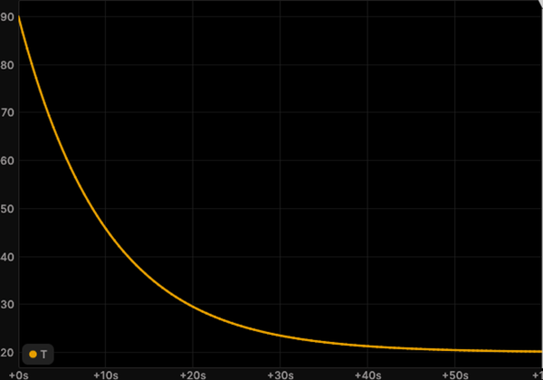<br><b>Physics</b><br><sub>Cooling coffee</sub></td>
    <td align="center" valign="top" width="33%">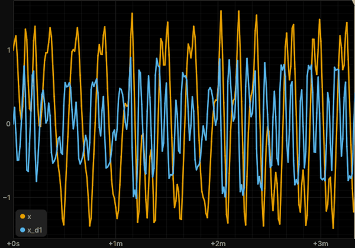<br><b>Physics</b><br><sub>Duffing</sub></td>
    <td align="center" valign="top" width="33%">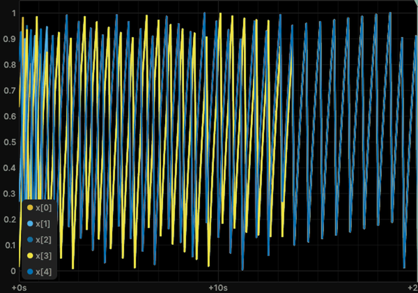<br><b>Physics</b><br><sub>Mirollo-Strogatz</sub></td>
  </tr>
  <tr>
    <td align="center" valign="top" width="33%">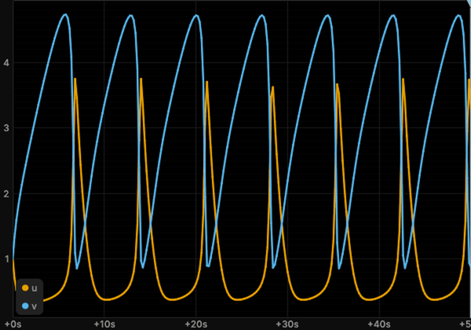<br><b>Chemistry</b><br><sub>Brusselator</sub></td>
    <td align="center" valign="top" width="33%">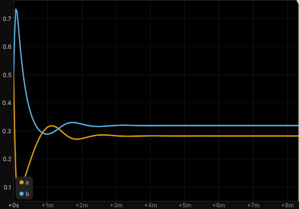<br><b>Chemistry</b><br><sub>Cubic autocatalysis</sub></td>
    <td align="center" valign="top" width="33%">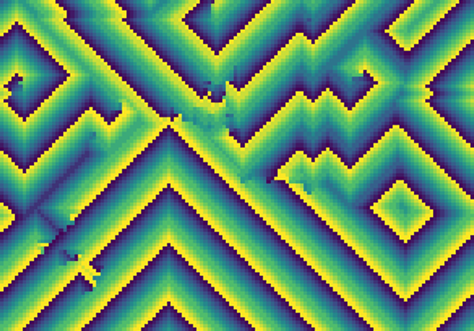<br><b>Chemistry</b><br><sub>Cyclic cellular automaton</sub></td>
  </tr>
  <tr>
    <td align="center" valign="top" width="33%">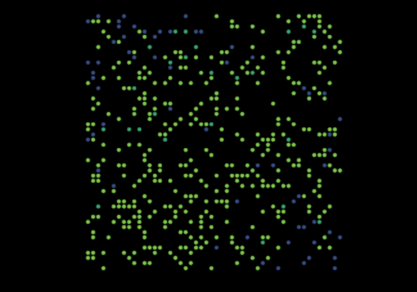<br><b>Biology</b><br><sub>Agent-based SIR</sub></td>
    <td align="center" valign="top" width="33%">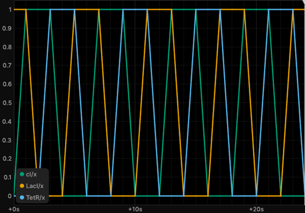<br><b>Biology</b><br><sub>Boolean repressilator</sub></td>
    <td align="center" valign="top" width="33%">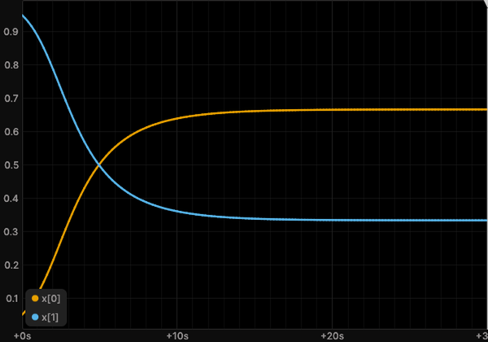<br><b>Biology</b><br><sub>Replicator dynamics</sub></td>
  </tr>
  <tr>
    <td align="center" valign="top" width="33%">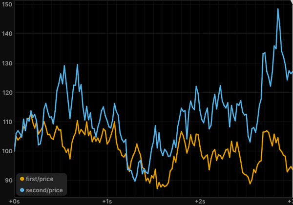<br><b>Economics</b><br><sub>Correlated geometric Brownian motions</sub></td>
    <td align="center" valign="top" width="33%">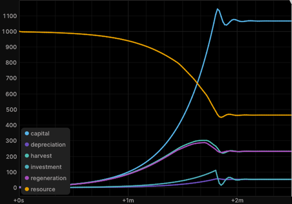<br><b>Economics</b><br><sub>Fishery capital</sub></td>
    <td align="center" valign="top" width="33%">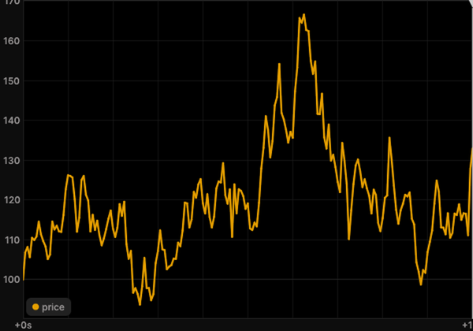<br><b>Economics</b><br><sub>Geometric Brownian motion</sub></td>
  </tr>
  <tr>
    <td align="center" valign="top" width="33%">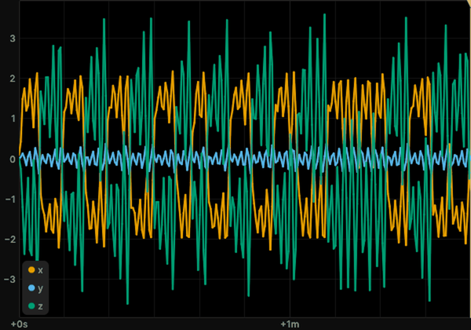<br><b>Engineering</b><br><sub>Chua's circuit</sub></td>
    <td align="center" valign="top" width="33%">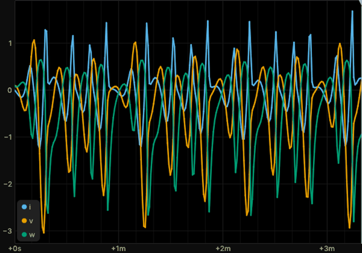<br><b>Engineering</b><br><sub>Memristor oscillator</sub></td>
    <td align="center" valign="top" width="33%">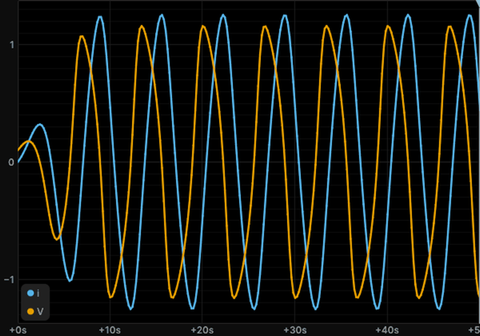<br><b>Engineering</b><br><sub>Tunnel-diode oscillator</sub></td>
  </tr>
  <tr>
    <td align="center" valign="top" width="33%">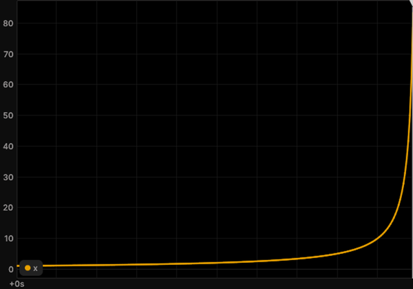<br><b>Mathematics</b><br><sub>Finite-time blow-up</sub></td>
    <td align="center" valign="top" width="33%">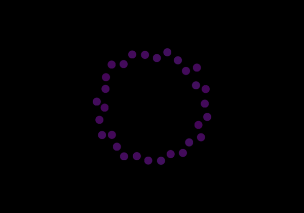<br><b>Mathematics</b><br><sub>Random walk on a hypergraph</sub></td>
    <td align="center" valign="top" width="33%">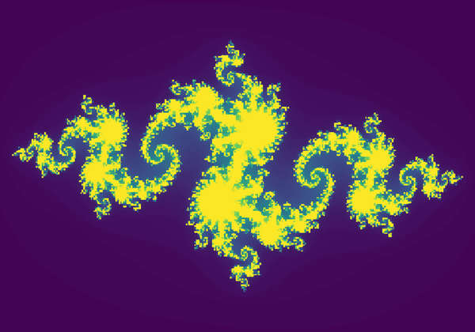<br><b>Mathematics</b><br><sub>Julia set</sub></td>
  </tr>
  <tr>
    <td align="center" valign="top" width="33%">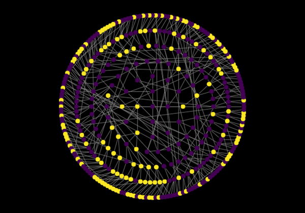<br><b>Computer science</b><br><sub>Majority automaton on the Baumslag-Solitar group</sub></td>
    <td align="center" valign="top" width="33%">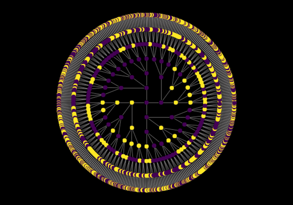<br><b>Computer science</b><br><sub>Majority automaton on the free group</sub></td>
    <td align="center" valign="top" width="33%">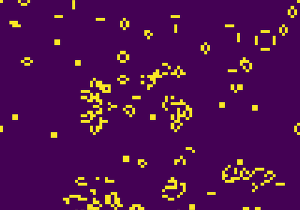<br><b>Computer science</b><br><sub>Game of Life</sub></td>
  </tr>
  <tr>
    <td align="center" valign="top" width="33%">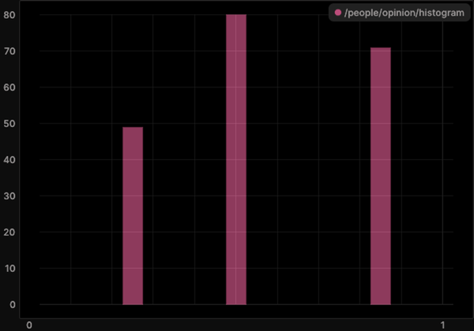<br><b>Social science</b><br><sub>Hegselmann-Krause</sub></td>
    <td align="center" valign="top" width="33%">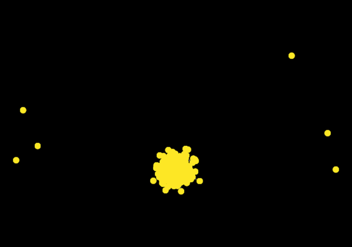<br><b>Social science</b><br><sub>Public goods game on a hypergraph</sub></td>
    <td align="center" valign="top" width="33%">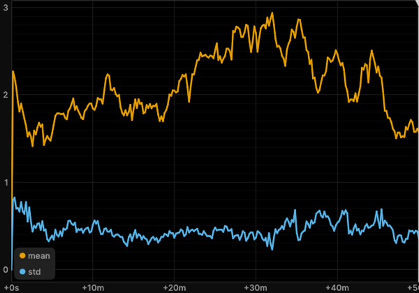<br><b>Social science</b><br><sub>Prisoner's dilemma tournament</sub></td>
  </tr>
</table>

<p align="center"><em>A few of the ready-to-run systems, each with a documented example in the
<a href="https://georgedouzas.github.io/scikit-complexity">gallery</a>.</em></p>

## Features

- **One interface for many kinds of dynamics.** Differential equations, stochastic processes, jump processes, discrete
  maps, cellular automata, agents, networks and hypergraphs, fields and partial differential equations, quantum
  systems, and systems that learn by gradient descent all run through `prepare` and `simulate`.
- **The problem is inferred.** The library reads the kinds of law of a system and decides what it is, such as
  ordinary differential equations for rates, a jump process for random events, a map for next values, or a
  minimisation for an objective. It then picks a default solver and compiles the system for NumPy, Numba, or JAX.
- **Solvers are settings.** The same reaction network runs as random jumps or as rate equations by changing only
  `solver=`, as `LogisticRegression` changes `solver` beside `C`.
- **Symbolic or numeric laws.** A law is a Sage symbolic expression, which you can inspect and solve exactly, or a
  Python function.
- **Live runs.** A simulation streams to Rerun as it runs, and a schedule changes its parameters during the run.
- **Analyses and experiments.** The analysis functions range from Lyapunov exponents and entropy to network motifs,
  scaling laws, and system identification. The experiment functions run parameter sweeps, sensitivity analyses,
  calibrations, and studies of basin stability.
- **Mature libraries underneath.** SciPy, NetworkX, Mesa, LAMMPS, QuTiP, JAX, and others do the numerical work.
- **Components of your own.** The ready-made systems use the same public classes as you do, so each one is also an
  example for a system of your own.

## Installation

`scikit-complexity` supports Python 3.12, 3.13, and 3.14 on Linux and on macOS 13 or later with Apple silicon. It is
available on PyPI. On Python 3.14 the install builds `memory-allocator` from source, so it needs a C compiler.

```bash
pip install scikit-complexity
```

The installation includes Sage through the [passagemath](https://github.com/passagemath/passagemath) distributions,
LAMMPS, Mesa, Numba, JAX, and Rerun. Windows has no passagemath wheels, so on Windows the package runs in WSL.

For development, clone the repository and install the project with [PDM](https://github.com/pdm-project/pdm).

```bash
git clone https://github.com/georgedouzas/scikit-complexity.git
cd scikit-complexity
pdm install
```

## Usage

The library follows the conventions of scikit-learn. A system is built from parts that hold parameters, it is prepared
once, as a model is fitted, and it is simulated many times, as a fitted model predicts:

- `prepare()` checks every part, works out the equations, chooses a solver, and returns the system.
- `simulate(until=...)` runs the prepared system and returns a trajectory, the values at every recorded time.
- `get_params`, `set_params`, and `clone` read, change, and copy the parameters, with nested names such as
  `gravity__g`.

Analyses and experiments are functions. An analysis measures a run, as `sklearn.metrics` scores a model, and an
experiment runs many copies of a system, as the model selection functions do.

You can start in two ways. Select a ready-made system from the catalog, or build a custom system from the classes of
`skcomplex.core`.

### Select a ready-made system

Every ready-made system is a class with a field, topics, references, and parameters. You import it from its subfield,
the package `skcomplex.systems.<field>.<subfield>`, and `all_systems` lists the classes, as `all_estimators` does in
scikit-learn.

```python
from skcomplex.systems import all_systems

ecology = [name for name, _ in all_systems(field='biology/ecology')]
oscillators = [name for name, _ in all_systems(topics='oscillation')]
stochastic = [name for name, _ in all_systems(field='chemistry', tags={'randomness': 'stochastic'})]
```

The class you choose says what it models and where it comes from.

```python continuation
from skcomplex.systems.biology.ecology import LotkaVolterraSystem

LotkaVolterraSystem.topics, LotkaVolterraSystem.references, LotkaVolterraSystem().get_params()
```

The topics of `LotkaVolterraSystem` are `predator-prey`, `ode`, and `oscillation`, its references are Lotka (1925) and
Volterra (1926), and its parameters start from 40 prey and 9 predators. `prepare().simulate()` runs it with its tuned
settings, or with parameters and settings of your own.

```python continuation
trajectory = LotkaVolterraSystem().prepare().simulate()
fast_prey = LotkaVolterraSystem(r=1.5).prepare().simulate(until=50, dt=0.1)
round(float(fast_prey.get_values('prey.x').max()))
```

With a prey growth rate of 1.5, the prey peak at 49. Each run can also stream to the Rerun viewer.

<table>
  <tr>
    <td align="center" valign="top" width="33%">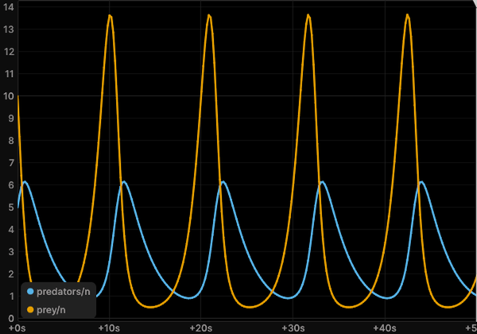<br><code>lotka_volterra</code><br><sub>Prey and predators cycle</sub></td>
    <td align="center" valign="top" width="33%">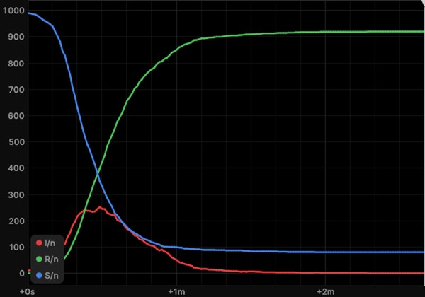<br><code>sir</code><br><sub>An epidemic rises and fades</sub></td>
    <td align="center" valign="top" width="33%">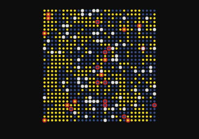<br><code>wolf_sheep</code><br><sub>Wolves, sheep and grass on a grid</sub></td>
  </tr>
</table>

The [catalog](https://georgedouzas.github.io/scikit-complexity/systems/catalog/) lists every system by field and topic,
and the page of each system shows the classes it is built from.

### Build a custom system

A system of your own has three kinds of part:

- An `Element` holds values, such as `Element('ball', values={'x': 10.0, 'm': 1.0})` for a ball at the height 10 with
  the mass 1.
- An `Interaction` binds elements through its roles and sets the laws that change their values. A class of your own
  sets them in `laws_` from its method `_prepare`, where `s` holds the values of the bound elements, the parameters of
  the interaction, and the time `s.t`. A rule used once needs no class: `Interaction(label, roles=..., laws=...)`.
- A `System` holds the elements and the interactions, and optionally a space, a solver, and a backend.

A value that some law changes is a state, and every other value is a parameter. Nobody declares which is which. Each
law is one of seven kinds, and the kinds a system holds decide what problem it is and which solver runs it by default.

| Law | What it says | Example |
| --- | --- | --- |
| `RateLaw` | how fast a value changes, `dx/dt = f(x)` | a falling ball, heat in a rod |
| `NoiseLaw` | a random kick added to the rate, `dx = g(x) dW` | a stock price |
| `JumpLaw` | a random event that changes values by whole amounts | one reaction between two molecules |
| `UpdateLaw` | the next value from the current one, `x_next = F(x)` | a cellular automaton |
| `ConstraintLaw` | an equation that must hold, `0 = g(x)` | the currents at a node of a circuit |
| `EventLaw` | a change made when a value crosses zero | a ball that bounces |
| `ObjectiveLaw` | a number to make small or to sample by | the energy of a magnet |

Four short systems follow, each on one kind of law.

#### A falling ball

Gravity pulls a ball down at 9.81 metres per second squared. The interaction `Gravity` binds the role `target` to the
ball and owns the parameter `g`. Its law says that the second derivative of the height `x` is `-g`, written in Sage as
`x.diff(t, 2)`.

```python
from skcomplex.core.components.elements import Element
from skcomplex.core.components.interactions import Interaction
from skcomplex.core.components.laws import RateLaw
from skcomplex.core.systems import System
from skcomplex.core.types import Role


class Gravity(Interaction):
    def __init__(self, label, *, target: Role, g=9.81):
        super().__init__(label)
        self.target = target
        self.g = g

    def _prepare(self, s):
        super()._prepare(s)
        self.laws_ = [RateLaw(s.target.x.diff(s.t, 2), -s.g)]


ball = Element('ball', values={'x': 10.0, 'm': 1.0})
system = System(elements=[ball], interactions=[Gravity('gravity', target='ball')]).prepare()
earth = system.simulate(until=1.4, dt=0.7)
system.states_, system.parameters_, system.equations_
```

The states are the height `ball.x` and its velocity `ball.x'`, the parameters are `ball.m` and `gravity.g`, and the
equations say that the height changes at the velocity and the velocity at `-gravity.g`. The run above starts the ball
at rest. One prepared system runs many times, here also thrown up at 3 metres per second, and `set_params` moves it to
the Moon.

```python continuation
thrown = system.simulate(until=1.4, dt=0.7, initial_state={"ball.x'": 3.0})
moon = system.set_params(gravity__g=1.62).prepare().simulate(until=1.4, dt=0.7)
earth.get_values('ball.x').round(2), thrown.get_values('ball.x').round(2), moon.get_values('ball.x').round(2)
```

After 1.4 seconds the ball is 0.39 metres above the ground on Earth, 4.59 metres when thrown up, and 8.41 metres on the
Moon. The same gravity written once, without a class, gives the same run.

```python continuation
gravity = Interaction('gravity', roles={'target': 'ball'}, laws=lambda s: [RateLaw(s.target.x.diff(s.t, 2), -9.81)])
System(elements=[ball], interactions=[gravity]).prepare().simulate(until=1.4, dt=0.7).get_values('ball.x').round(2)
```

#### A reaction network with two solvers

In the reaction `A + B -> C`, each meeting of one molecule of `A` and one of `B` makes one molecule of `C`. A `JumpLaw`
fires at the rate `k a b` and changes the counts by whole molecules. Its system is a jump process, run by the exact
algorithm of Gillespie. The same system given an ODE solver runs the mean of the jumps instead, as the rate equations
of chemistry.

```python continuation
from skcomplex.core.components.elements import Element
from skcomplex.core.components.interactions import Interaction
from skcomplex.core.components.laws import JumpLaw
from skcomplex.core.engine.solvers import ScipyODESolver
from skcomplex.core.systems import System
from skcomplex.core.types import Role


class Reaction(Interaction):
    def __init__(self, label, *, a: Role, b: Role, c: Role, k=0.01):
        super().__init__(label)
        self.a = a
        self.b = b
        self.c = c
        self.k = k

    def _prepare(self, s):
        super()._prepare(s)
        a, b, c = s.a.n, s.b.n, s.c.n
        self.laws_ = [JumpLaw(s.k * a * b, {a: -1, b: -1, c: +1})]


molecules = [Element('A', values={'n': 100}), Element('B', values={'n': 80}), Element('C', values={'n': 0})]
reaction = Reaction('bind', a='A', b='B', c='C')
jumps = System(elements=molecules, interactions=[reaction]).prepare()
mean = System(elements=molecules, interactions=[reaction], solver=ScipyODESolver()).prepare()
jumps.form_, mean.form_
```

The first system is a jump process and the second ordinary differential equations. Both make about 70 molecules of `C`
in five time units.

```python continuation
counted = jumps.simulate(until=5, dt=1, random_state=0).get_values('C.n')
averaged = mean.simulate(until=5, dt=1).get_values('C.n')
counted.tolist(), averaged.round(1).tolist()
```

The jumps count 43, 58, 65, 68, and 69 molecules after one to five time units, whole numbers that change with the
seed, and the mean grows smoothly through 42.0, 56.9, 64.3, 68.8, and 71.7.

#### Heat in a rod

A rod of 21 cells starts cold, with one unit of heat in its middle cell, and its two ends are held at zero. An element
with `space=` holds one member on every site of the space, here a `LatticeSpace` of 21 sites, so its value `u` is one
number per cell. The law reads `laplacian(u)`, which the space works out from the neighbours of each cell, and gives
the heat equation `du/dt = D laplacian(u)`.

```python continuation
import numpy as np

from skcomplex.core.components.elements import Element
from skcomplex.core.components.interactions import Interaction
from skcomplex.core.components.laws import RateLaw
from skcomplex.core.components.laws.utils import laplacian
from skcomplex.core.components.spaces import LatticeSpace
from skcomplex.core.systems import System
from skcomplex.core.types import Role


class Conduction(Interaction):
    def __init__(self, label, *, target: Role, D=1.0):
        super().__init__(label)
        self.target = target
        self.D = D

    def _prepare(self, s):
        super()._prepare(s)
        u = s.target.u
        self.laws_ = [RateLaw(u.diff(s.t), s.D * laplacian(u))]


start = np.zeros(21)
start[10] = 1.0
rod = Element('rod', values={'u': start}, space=LatticeSpace(21, boundary={'u': ('fixed', 0.0)}))
heat = System(elements=[rod], interactions=[Conduction('conduction', target='rod')]).prepare()
heat.equations_
```

The prepared system has one equation for every cell `i`, `conduction.D*laplacian(rod.u[i])`.

```python continuation
heat.simulate(until=2, dt=1).get_values('rod.u').max(axis=1).round(3).tolist()
```

The hottest cell cools from 1 to 0.309 after one time unit and to 0.207 after two, as the heat spreads to its
neighbours.

#### A magnet

In the Ising model every site of a square lattice holds a spin of plus or minus one, and neighbouring spins lower the
energy when they point the same way. An `ObjectiveLaw` gives the energy of each spin over the temperature `T`, and the
`MetropolisSolver` flips spins at random, keeping a flip more often the more it lowers the energy. `neighbors` reads
the spins of the four nearest sites.

```python continuation
import numpy as np

from skcomplex.core.components.elements import Element
from skcomplex.core.components.interactions import Interaction
from skcomplex.core.components.laws import ObjectiveLaw
from skcomplex.core.components.laws.utils import neighbors
from skcomplex.core.components.spaces import LatticeNeighborhood, LatticeSpace
from skcomplex.core.engine.solvers import MetropolisSolver
from skcomplex.core.systems import System
from skcomplex.core.types import Role

NEAREST = LatticeNeighborhood(((-1, 0), (0, -1), (0, 1), (1, 0)))


class Ising(Interaction):
    def __init__(self, label, *, target: Role, J=1.0, T=2.0):
        super().__init__(label)
        self.target = target
        self.J = J
        self.T = T

    def _prepare(self, s):
        super()._prepare(s)
        spin = s.target.spin
        energy = -s.J * spin * sum(neighbors(spin, NEAREST, reduce='each'))
        self.laws_ = [ObjectiveLaw(energy / s.T, spin)]


spins = Element('spins', values={'spin': np.ones(256)}, space=LatticeSpace((16, 16)))
magnet = System(
    elements=[spins],
    interactions=[Ising('ising', target='spins', T=1.5)],
    solver=MetropolisSolver(moves={'spins.spin': 'flip'}, neighborhood=NEAREST),
)
order = []
for temperature in (1.5, 3.5):
    run = magnet.set_params(ising__T=temperature).prepare().simulate(until=200, random_state=0)
    order.append(float(np.abs(run.get_values('spins.spin')[50:].mean(axis=1)).mean().round(2)))
order
```

One unit of time is one sweep, a proposed flip of every spin. After 50 sweeps the mean spin stays near 0.99 at
`T = 1.5`, where the spins stay aligned, and falls to 0.12 at `T = 3.5`, where heat scrambles them. The exact
transition of the square lattice lies at about 2.27.

### Record a run and change it as it runs

A `RerunObserver` records a run for the [Rerun](https://rerun.io) viewer, and `RerunObserver('ball', spawn=True)`
opens the viewer during the run. A schedule changes a parameter while the system runs, here gravity that weakens to a
tenth after 0.7 seconds.

```python continuation
import tempfile
from pathlib import Path

from skcomplex.core.engine.viz import RerunObserver

recording = Path(tempfile.mkdtemp()) / 'ball.rrd'
falling = System(elements=[ball], interactions=[Gravity('gravity', target='ball')]).prepare()
trajectory = falling.simulate(
    until=1.4,
    dt=0.7,
    observers=[RerunObserver('ball', save_path=recording)],
    schedule={'gravity.g': lambda t: 9.81 if t < 0.7 else 0.981},
)
trajectory.get_values('ball.x').round(2).tolist()
```

The ball falls to 7.6 metres in the first 0.7 seconds. It then gains speed more slowly and ends at 2.55 metres, where
full gravity would have brought it to 0.39.

### Find out which parts fit

`prepare` checks that every element bound to a role carries the values its interaction reads. Here the role `target`
of `Gravity` is bound to a tank, which carries a level and no height.

```python continuation
from skcomplex.core.errors import RoleElementError

wrong = System(elements=[Element('tank', values={'level': 1.0})], interactions=[Gravity('gravity', target='tank')])
try:
    wrong.prepare()
except RoleElementError as error:
    message = str(error)
message
```

The message says that the role `target` reads `x` but the element `tank` carries `level`, and it proposes three fixes:
bind the role to an element that carries the value, give the element that value, or read another value.

The [component pages](https://georgedouzas.github.io/scikit-complexity/components/elements/) list every element,
interaction, law, solver, and backend with the tags they accept, and the
[user guide](https://georgedouzas.github.io/scikit-complexity/overview/user_guide/) walks through the whole workflow
with these four systems.

## Spec-driven development

The project develops from specifications with [OpenSpec](https://github.com/Fission-AI/OpenSpec). Its engineering
constitution, `openspec/constitution.md`, binds all work, and `openspec/config.yaml` names it as binding.
