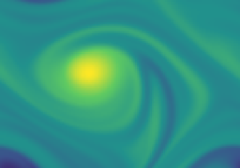
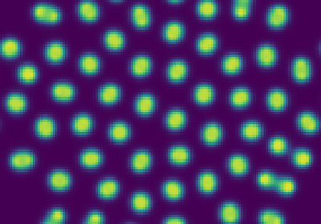
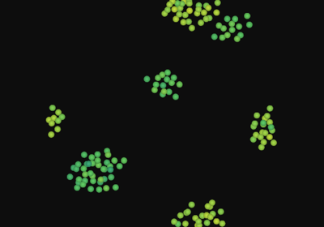
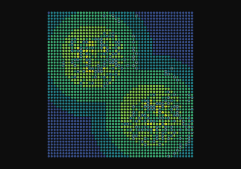
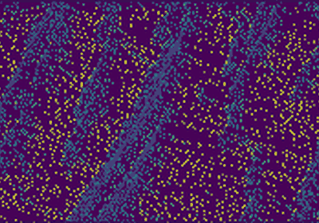
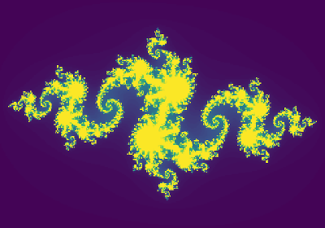
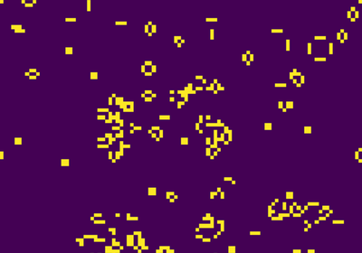
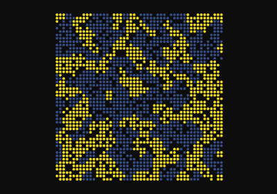

[black badge]: <https://img.shields.io/badge/%20style-black-000000.svg>
[black]: <https://github.com/psf/black>
[docformatter badge]: <https://img.shields.io/badge/%20formatter-docformatter-fedcba.svg>
[docformatter]: <https://github.com/PyCQA/docformatter>
[ruff badge]: <https://img.shields.io/endpoint?url=https://raw.githubusercontent.com/charliermarsh/ruff/main/assets/badge/v1.json>
[ruff]: <https://github.com/charliermarsh/ruff>
[mypy badge]: <http://www.mypy-lang.org/static/mypy_badge.svg>
[mypy]: <http://mypy-lang.org>
[properdocs badge]: <https://img.shields.io/badge/docs-properdocs-blue.svg?style=flat>
[properdocs]: <https://properdocs.org>
[pip-audit badge]: <https://img.shields.io/badge/security-pip--audit-green>
[pip-audit]: <https://github.com/pypa/pip-audit>
[bandit badge]: <https://img.shields.io/badge/security-bandit-yellow>
[bandit]: <https://github.com/PyCQA/bandit>
[pytest badge]: <https://img.shields.io/badge/tests-pytest-blue>
[pytest]: <https://github.com/pytest-dev/pytest>
[coverage badge]: <https://img.shields.io/badge/coverage-pytest--cov-blue>
[coverage]: <https://github.com/nedbat/coveragepy>
[interrogate badge]: <https://img.shields.io/badge/docstring-interrogate-blue>
[interrogate]: <https://github.com/econchick/interrogate>
[pre-commit badge]: <https://img.shields.io/badge/pre--commit-enabled-brightgreen?logo=pre-commit>
[pre-commit]: <https://github.com/pre-commit/pre-commit>
[nox badge]: <https://img.shields.io/badge/%F0%9F%A6%8A-Nox-D85E00.svg>
[nox]: <https://github.com/wntrblm/nox>
[version badge]: <https://img.shields.io/pypi/v/scikit-complexity.svg>
[pythonversion badge]: <https://img.shields.io/pypi/pyversions/scikit-complexity.svg>
[downloads badge]: <https://img.shields.io/pypi/dd/scikit-complexity>
[discussions]: <https://github.com/georgedouzas/scikit-complexity/discussions>
[discussions badge]: <https://img.shields.io/github/discussions/georgedouzas/scikit-complexity>
[ci]: <https://github.com/georgedouzas/scikit-complexity/actions?query=workflow>
[ci badge]: <https://github.com/georgedouzas/scikit-complexity/actions/workflows/ci.yml/badge.svg?branch=main>
[doc]: <https://github.com/georgedouzas/scikit-complexity/actions?query=workflow>
[doc badge]: <https://github.com/georgedouzas/scikit-complexity/actions/workflows/doc.yml/badge.svg?branch=main>

# scikit-complexity

| Category          | Tools    |
| ------------------| -------- |
| **Development**   | [![black][black badge]][black] [![ruff][ruff badge]][ruff] [![mypy][mypy badge]][mypy] [![docformatter][docformatter badge]][docformatter] |
| **Testing**       | [![pytest][pytest badge]][pytest] [![coverage][coverage badge]][coverage] [![interrogate][interrogate badge]][interrogate] |
| **Security**      | [![pip-audit][pip-audit badge]][pip-audit] [![bandit][bandit badge]][bandit] |
| **Automation**    | [![nox][nox badge]][nox] [![pre-commit][pre-commit badge]][pre-commit] |
| **Package**       | ![version][version badge] ![pythonversion][pythonversion badge] ![downloads][downloads badge] |
| **Documentation** | [![properdocs][properdocs badge]][properdocs]|
| **Communication** | [![discussions][discussions badge]][discussions] |

## One framework for complex systems, from turbulence to traffic

**`scikit-complexity` lets you describe a model from any science in a few lines, and takes care of the rest:** it works
out the mathematics, picks a solver, runs the simulation, and streams it live to the [Rerun](https://rerun.io) viewer.

Flocks, epidemics, markets, fluids, neural networks and cellular automata are usually written in separate tools with
separate conventions. Here they share one small vocabulary, in the spirit of scikit-learn: **elements** carry state,
**interactions** change it through laws, and **systems** nest and compose. Learn it once, and every field opens up.

<table>
  <tr>
    <td align="center" valign="top" width="25%"><br><b>Physics</b><br><sub>Decaying 2D turbulence</sub></td>
    <td align="center" valign="top" width="25%"><br><b>Chemistry</b><br><sub>Gray-Scott patterns</sub></td>
    <td align="center" valign="top" width="25%"><br><b>Biology</b><br><sub>Boids flocking</sub></td>
    <td align="center" valign="top" width="25%"><br><b>Economics</b><br><sub>Sugarscape</sub></td>
  </tr>
  <tr>
    <td align="center" valign="top" width="25%"><br><b>Engineering</b><br><sub>Nagel-Schreckenberg traffic</sub></td>
    <td align="center" valign="top" width="25%"><br><b>Mathematics</b><br><sub>Julia sets</sub></td>
    <td align="center" valign="top" width="25%"><br><b>Computer science</b><br><sub>Game of Life</sub></td>
    <td align="center" valign="top" width="25%"><br><b>Social science</b><br><sub>Schelling segregation</sub></td>
  </tr>
</table>

<p align="center"><em>A few of the <b>549 ready-to-run models</b>, each with a documented example in the
<a href="https://georgedouzas.github.io/scikit-complexity">gallery</a>.</em></p>

### Find a model

Every model comes with a description, tags, parameters and references, so you can browse the catalog from Python:

```python
from skcomplex.models import catalog, describe

for model in catalog(field='biology/ecology'):
    print(model.name, '-', model.description)

print([model.name for model in catalog() if 'oscillation' in model.tags])

entry = describe('lotka_volterra')
print(entry.description, entry.formalism, entry.parameters, entry.references)
```

### Try a model in one line

```python
from skcomplex.models import run

trajectory = run('sir').trajectory_
print(trajectory.values('I.n').max().round())
```

### Why scikit-complexity

- **Every kind of dynamics, one interface.** Differential equations, stochastic processes, jump processes, discrete maps,
  cellular automata, agents, networks and hypergraphs, fields and PDEs, quantum systems, and models that learn by gradient
  descent.
- **The form of your model is inferred.** Write the laws; the framework decides whether it is an ODE, an SDE or a jump
  process, and compiles it for NumPy, Numba, or JAX.
- **Symbols when you want them, code when you don't.** Laws are Sage symbolic expressions you can inspect and solve exactly,
  or plain Python functions.
- **Watch it run.** Stream any simulation to Rerun in real time, and change its parameters while it runs.
- **Analysis included.** Nearly 50 analyses, from Lyapunov exponents and entropy to network motifs, scaling laws and system
  identification, plus experiments for parameter sweeps, sensitivity, calibration and basin stability.
- **Standing on mature libraries.** SciPy, NetworkX, Mesa, LAMMPS, QuTiP, JAX and others do the heavy lifting.
- **Extend it, don't fork it.** Models are written with the same public classes you use, so each one doubles as an example
  for your own.

## Installation

`scikit-complexity` supports Python 3.12 and 3.13 on Linux and on macOS 13 or later with Apple silicon, and is available on
PyPI:

```bash
pip install scikit-complexity
```

The installation includes Sage through the [passagemath](https://github.com/passagemath/passagemath) distributions,
LAMMPS, Mesa, Numba, JAX, and Rerun. Windows has no passagemath wheels, so on Windows the package runs in WSL.

For development, clone the repository and install the project with [PDM](https://github.com/pdm-project/pdm):

```bash
git clone https://github.com/georgedouzas/scikit-complexity.git
cd scikit-complexity
pdm install
```

## Build your own model

A predator and prey model assembles from ready-made interactions:

```python
from skcomplex.core.system import System
from skcomplex.models.biology.common.populations import (
    LogisticGrowthInteraction,
    MortalityInteraction,
    PopulationElement,
)
from skcomplex.models.biology.ecology import PredationInteraction

system = System(
    elements=[PopulationElement('rabbits', n=40), PopulationElement('foxes', n=9)],
    interactions=[
        LogisticGrowthInteraction('growth', target='rabbits', r=1.1, K=1000),
        PredationInteraction('hunt', predator='foxes', prey='rabbits', a=0.4, b=0.1),
        MortalityInteraction('death', target='foxes', d=0.4),
    ],
)
```

A simulation runs it and records the trajectory. Adding a `RerunObserver` streams the run to the Rerun viewer, and a
`RealTimeClock` paces it against wall time:

```python continuation
from skcomplex.engine.runtime import RealTimeClock, Simulation
from skcomplex.engine.viz import RerunObserver

simulation = Simulation(
    system,
    dt=0.05,
    clock=RealTimeClock(speed=20.0),
    observers=[RerunObserver('lotka-volterra', spawn=True)],
).check().prepare()
trajectory = simulation.run(until=30).trajectory_
print(round(float(trajectory.values('rabbits.n').max())))
```

A simulation started with `start` runs in the background, and its parameters can change while it runs:

```python continuation
from skcomplex.engine.runtime import RealTimeClock, Simulation

simulation = Simulation(system, dt=0.05, clock=RealTimeClock(speed=20.0)).check().prepare().start(until=30)
simulation.update_parameters({'hunt.a': 0.2})
simulation.wait()
```

A new interaction takes a few lines. It declares its roles and parameters as annotated arguments of its constructor,
and returns its laws from `_get_laws`, where the namespace `s` holds the symbols of its parameters and of the elements
bound to its roles:

```python
from typing import Annotated

from sage.all__sagemath_symbolics import oo
from sage.sets.real_set import RealSet

from skcomplex.analysis import SymbolicAnalysis
from skcomplex.core.interactions import Interaction
from skcomplex.core.laws import RateLaw
from skcomplex.specs import ParameterSpec, RoleSpec
from skcomplex.core.system import System
from skcomplex.models.biology.common.populations import LogisticGrowthInteraction, PopulationElement


class HarvestInteraction(Interaction):
    def __init__(
        self,
        label,
        *,
        target: Annotated[str, RoleSpec()],
        h: Annotated[float, ParameterSpec(domain=RealSet.closed_open(0, oo))] = 0.1,
    ):
        super().__init__(label)
        self.target = target
        self.h = h

    def _get_laws(self, s):
        return [RateLaw(s.target.n, -s.h * s.target.n)]


harvested = System(
    elements=[PopulationElement('fish', n=500)],
    interactions=[
        LogisticGrowthInteraction('growth', target='fish', r=0.5, K=1000),
        HarvestInteraction('fishing', target='fish', h=0.1),
    ],
)
print(SymbolicAnalysis().check().prepare(harvested).run().equations_['fish.n'])
```

## Spec-driven development

The project's engineering constitution lives in `openspec/constitution.md` and binds all work. The
project uses [OpenSpec](https://github.com/Fission-AI/OpenSpec) for spec-driven development, and
`openspec/config.yaml` names the constitution as binding.
