[black badge]: <https://img.shields.io/badge/%20style-black-000000.svg>
[black]: <https://github.com/psf/black>
[docformatter badge]: <https://img.shields.io/badge/%20formatter-docformatter-fedcba.svg>
[docformatter]: <https://github.com/PyCQA/docformatter>
[ruff badge]: <https://img.shields.io/endpoint?url=https://raw.githubusercontent.com/charliermarsh/ruff/main/assets/badge/v1.json>
[ruff]: <https://github.com/charliermarsh/ruff>
[mypy badge]: <http://www.mypy-lang.org/static/mypy_badge.svg>
[mypy]: <http://mypy-lang.org>
[properdocs badge]: <https://img.shields.io/badge/docs-properdocs-blue.svg?style=flat>
[properdocs]: <https://properdocs.org>
[pip-audit badge]: <https://img.shields.io/badge/security-pip--audit-green>
[pip-audit]: <https://github.com/pypa/pip-audit>
[bandit badge]: <https://img.shields.io/badge/security-bandit-yellow>
[bandit]: <https://github.com/PyCQA/bandit>
[pytest badge]: <https://img.shields.io/badge/tests-pytest-blue>
[pytest]: <https://github.com/pytest-dev/pytest>
[coverage badge]: <https://img.shields.io/badge/coverage-pytest--cov-blue>
[coverage]: <https://github.com/nedbat/coveragepy>
[interrogate badge]: <https://img.shields.io/badge/docstring-interrogate-blue>
[interrogate]: <https://github.com/econchick/interrogate>
[pre-commit badge]: <https://img.shields.io/badge/pre--commit-enabled-brightgreen?logo=pre-commit>
[pre-commit]: <https://github.com/pre-commit/pre-commit>
[nox badge]: <https://img.shields.io/badge/%F0%9F%A6%8A-Nox-D85E00.svg>
[nox]: <https://github.com/wntrblm/nox>
[version badge]: <https://img.shields.io/pypi/v/scikit-complexity.svg>
[pythonversion badge]: <https://img.shields.io/pypi/pyversions/scikit-complexity.svg>
[downloads badge]: <https://img.shields.io/pypi/dd/scikit-complexity>
[discussions]: <https://github.com/georgedouzas/scikit-complexity/discussions>
[discussions badge]: <https://img.shields.io/github/discussions/georgedouzas/scikit-complexity>
[ci]: <https://github.com/georgedouzas/scikit-complexity/actions?query=workflow>
[ci badge]: <https://github.com/georgedouzas/scikit-complexity/actions/workflows/ci.yml/badge.svg?branch=main>
[doc]: <https://github.com/georgedouzas/scikit-complexity/actions?query=workflow>
[doc badge]: <https://github.com/georgedouzas/scikit-complexity/actions/workflows/doc.yml/badge.svg?branch=main>

# scikit-complexity

| Category          | Tools    |
| ------------------| -------- |
| **Development**   | [![black][black badge]][black] [![ruff][ruff badge]][ruff] [![mypy][mypy badge]][mypy] [![docformatter][docformatter badge]][docformatter] |
| **Testing**       | [![pytest][pytest badge]][pytest] [![coverage][coverage badge]][coverage] [![interrogate][interrogate badge]][interrogate] |
| **Security**      | [![pip-audit][pip-audit badge]][pip-audit] [![bandit][bandit badge]][bandit] |
| **Automation**    | [![nox][nox badge]][nox] [![pre-commit][pre-commit badge]][pre-commit] |
| **Package**       | ![version][version badge] ![pythonversion][pythonversion badge] ![downloads][downloads badge] |
| **Documentation** | [![properdocs][properdocs badge]][properdocs]|
| **Communication** | [![discussions][discussions badge]][discussions] |

## Overview

`scikit-complexity` simulates and analyses complex systems from any field of science. You describe a system by its
parts, and the library derives its equations, picks a solver unless you choose one, runs the simulation, and can stream
it to the [Rerun](https://rerun.io) viewer.

Complex systems are usually modelled in separate tools, often one for each field, each with its own conventions. Here
every field shares one small vocabulary in the style of [scikit-learn](https://scikit-learn.org). Elements carry
states, interactions change them through laws, and systems nest and compose.

<table>
  <tr>
    <td align="center" valign="top" width="33%">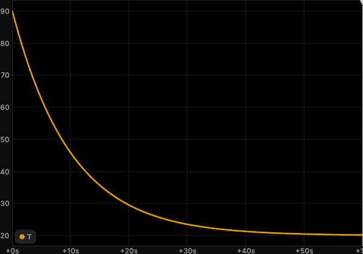<br><b>Physics</b><br><sub>Cooling coffee</sub></td>
    <td align="center" valign="top" width="33%">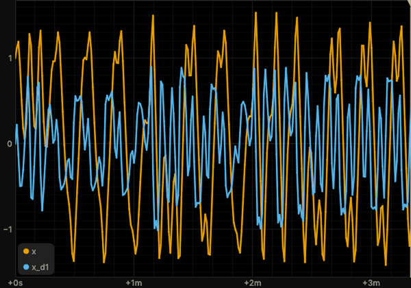<br><b>Physics</b><br><sub>Duffing</sub></td>
    <td align="center" valign="top" width="33%">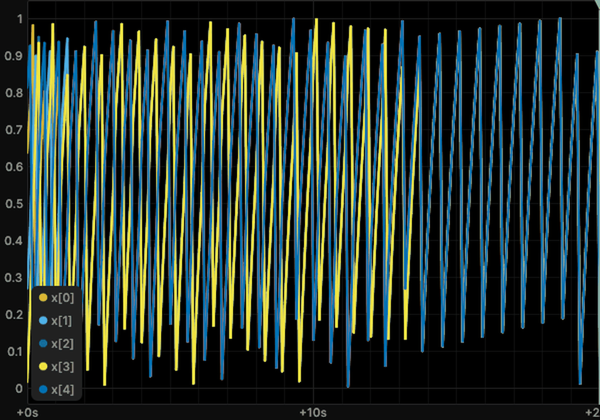<br><b>Physics</b><br><sub>Mirollo-Strogatz</sub></td>
  </tr>
  <tr>
    <td align="center" valign="top" width="33%">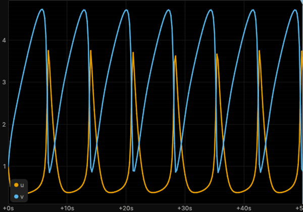<br><b>Chemistry</b><br><sub>Brusselator</sub></td>
    <td align="center" valign="top" width="33%">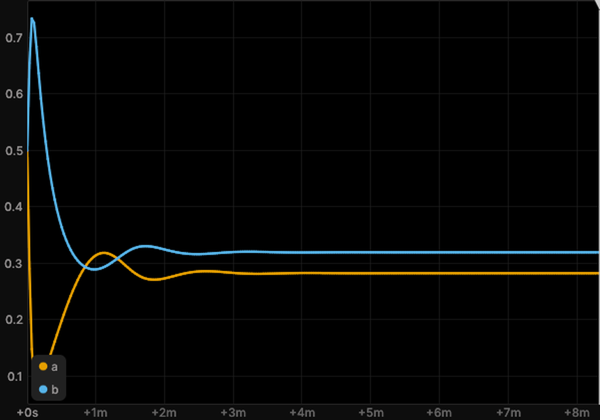<br><b>Chemistry</b><br><sub>Cubic autocatalysis</sub></td>
    <td align="center" valign="top" width="33%">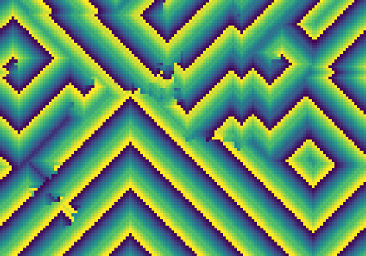<br><b>Chemistry</b><br><sub>Cyclic cellular automaton</sub></td>
  </tr>
  <tr>
    <td align="center" valign="top" width="33%">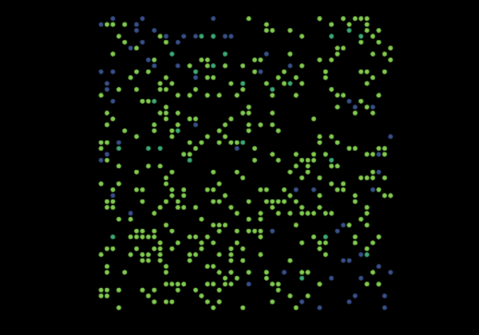<br><b>Biology</b><br><sub>Agent-based SIR</sub></td>
    <td align="center" valign="top" width="33%">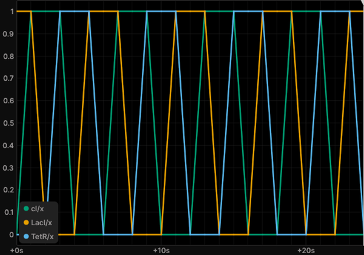<br><b>Biology</b><br><sub>Boolean repressilator</sub></td>
    <td align="center" valign="top" width="33%">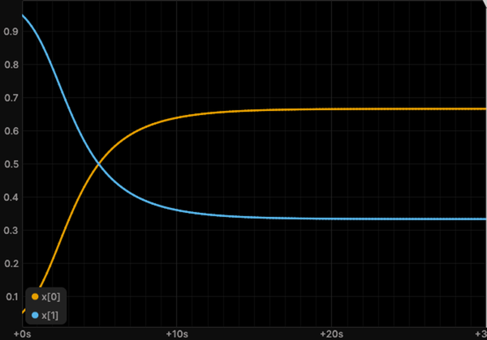<br><b>Biology</b><br><sub>Replicator dynamics</sub></td>
  </tr>
  <tr>
    <td align="center" valign="top" width="33%">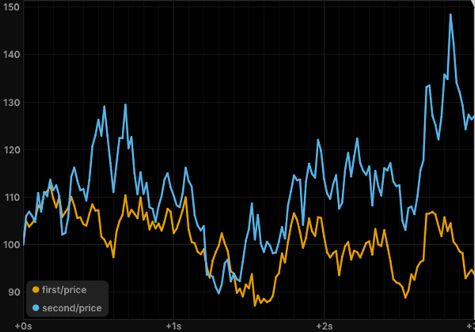<br><b>Economics</b><br><sub>Correlated geometric Brownian motions</sub></td>
    <td align="center" valign="top" width="33%">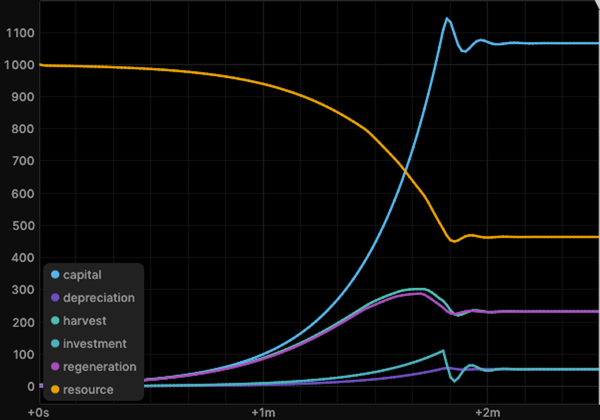<br><b>Economics</b><br><sub>Fishery capital</sub></td>
    <td align="center" valign="top" width="33%">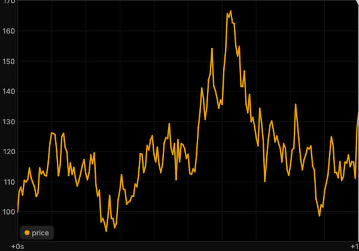<br><b>Economics</b><br><sub>Geometric Brownian motion</sub></td>
  </tr>
  <tr>
    <td align="center" valign="top" width="33%">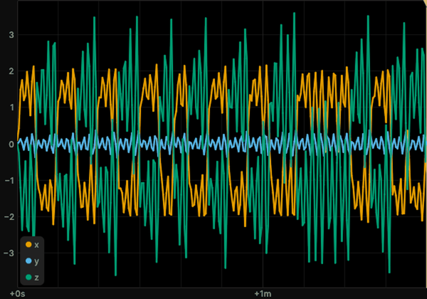<br><b>Engineering</b><br><sub>Chua's circuit</sub></td>
    <td align="center" valign="top" width="33%">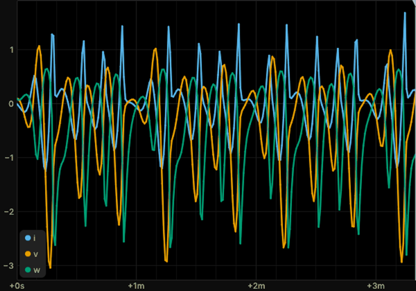<br><b>Engineering</b><br><sub>Memristor oscillator</sub></td>
    <td align="center" valign="top" width="33%">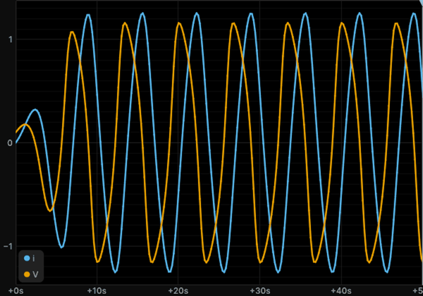<br><b>Engineering</b><br><sub>Tunnel-diode oscillator</sub></td>
  </tr>
  <tr>
    <td align="center" valign="top" width="33%">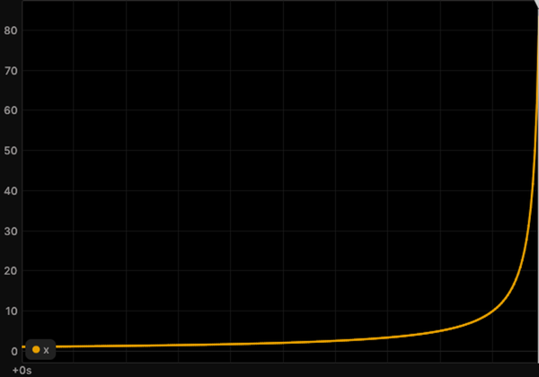<br><b>Mathematics</b><br><sub>Finite-time blow-up</sub></td>
    <td align="center" valign="top" width="33%">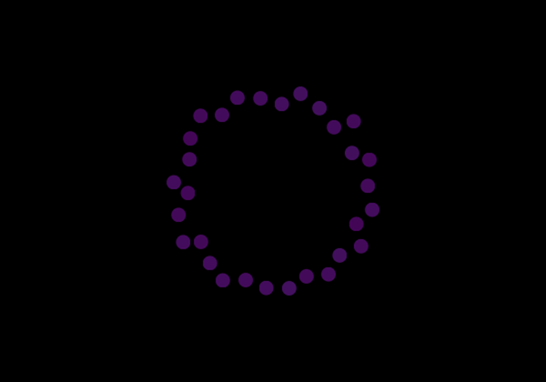<br><b>Mathematics</b><br><sub>Random walk on a hypergraph</sub></td>
    <td align="center" valign="top" width="33%">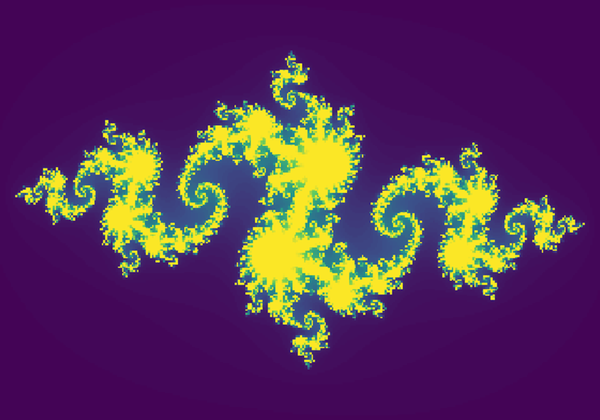<br><b>Mathematics</b><br><sub>Julia set</sub></td>
  </tr>
  <tr>
    <td align="center" valign="top" width="33%">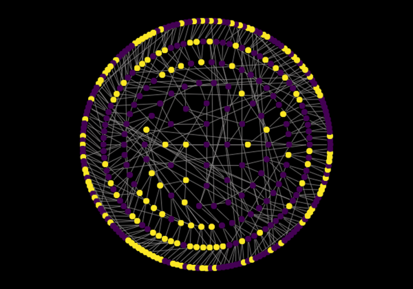<br><b>Computer science</b><br><sub>Majority automaton on the Baumslag-Solitar group</sub></td>
    <td align="center" valign="top" width="33%">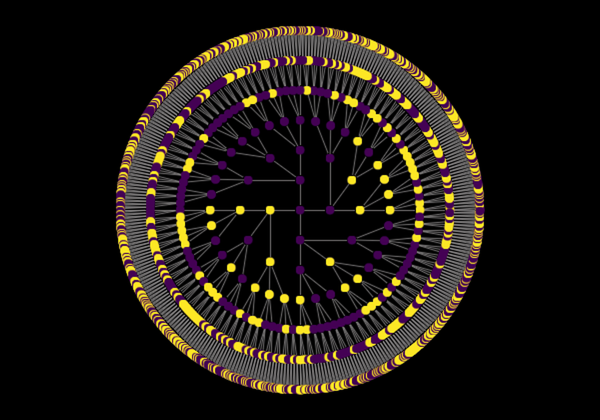<br><b>Computer science</b><br><sub>Majority automaton on the free group</sub></td>
    <td align="center" valign="top" width="33%">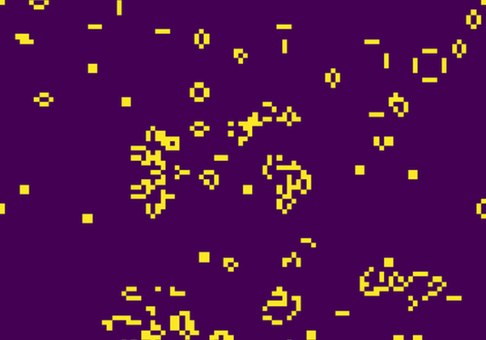<br><b>Computer science</b><br><sub>Game of Life</sub></td>
  </tr>
  <tr>
    <td align="center" valign="top" width="33%">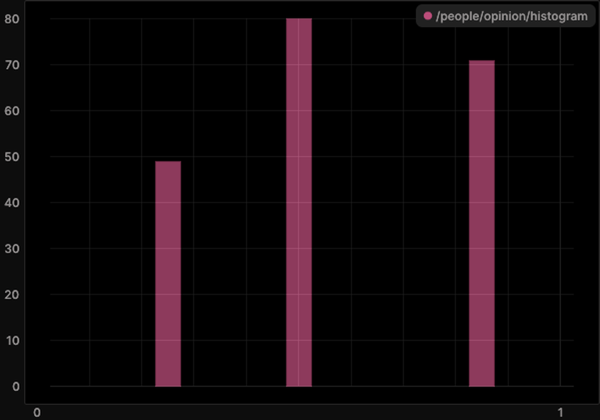<br><b>Social science</b><br><sub>Hegselmann-Krause</sub></td>
    <td align="center" valign="top" width="33%">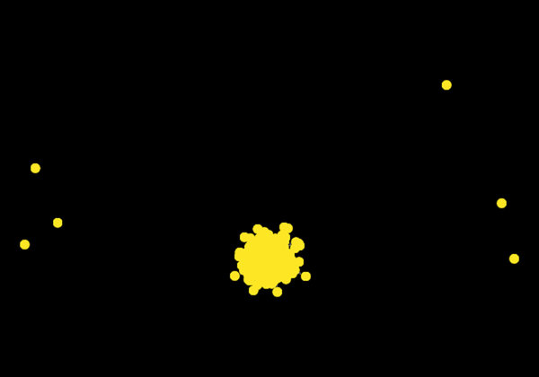<br><b>Social science</b><br><sub>Public goods game on a hypergraph</sub></td>
    <td align="center" valign="top" width="33%">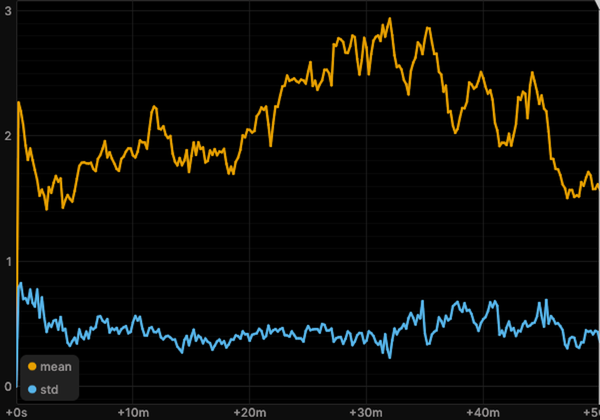<br><b>Social science</b><br><sub>Prisoner's dilemma tournament</sub></td>
  </tr>
</table>

<p align="center"><em>A few of the ready-to-run systems, each with a documented example in the
<a href="https://georgedouzas.github.io/scikit-complexity">gallery</a>.</em></p>

## Features

- **One interface for many kinds of dynamics.** Differential equations, stochastic processes, jump processes, discrete
  maps, cellular automata, agents, networks and hypergraphs, fields and partial differential equations, quantum
  systems, and systems that learn by gradient descent all run through `simulate`.
- **The form is inferred.** The library reads the laws of a system and decides whether it is an ordinary differential
  equation, a stochastic differential equation, or a jump process. It then compiles it for NumPy, Numba, or JAX.
- **Symbolic or numeric laws.** A law is a Sage symbolic expression, which you can inspect and solve exactly, or a
  Python function.
- **Live runs.** A simulation streams to Rerun as it runs, and a schedule changes its parameters during the run.
- **Analyses and experiments.** The analysis functions range from Lyapunov exponents and entropy to network motifs,
  scaling laws, and system identification. The experiment functions run parameter sweeps, sensitivity analyses,
  calibrations, and studies of basin stability.
- **Mature libraries underneath.** SciPy, NetworkX, Mesa, LAMMPS, QuTiP, JAX, and others do the numerical work.
- **Parts of your own.** The ready-made systems use the same public classes as you do, so each one is also an example
  for a system of your own.

## Installation

`scikit-complexity` supports Python 3.12, 3.13, and 3.14 on Linux and on macOS 13 or later with Apple silicon. It is
available on PyPI. On Python 3.14 the install builds `memory-allocator` from source, so it needs a C compiler.

```bash
pip install scikit-complexity
```

The installation includes Sage through the [passagemath](https://github.com/passagemath/passagemath) distributions,
LAMMPS, Mesa, Numba, JAX, and Rerun. Windows has no passagemath wheels, so on Windows the package runs in WSL.

For development, clone the repository and install the project with [PDM](https://github.com/pdm-project/pdm).

```bash
git clone https://github.com/georgedouzas/scikit-complexity.git
cd scikit-complexity
pdm install
```

## Usage

The library follows the conventions of scikit-learn. What you define is an estimator, a class with `get_params`,
`set_params`, and `clone`, such as an element, an interaction, or a system. What you do to it is a function. `simulate`
runs a system as `cross_validate` runs a model, an analysis measures the run as `sklearn.metrics` scores a model, and
an experiment runs many systems as the model selection functions do.

You can start in two ways. Select a ready-made system from the catalog, or build a custom system from the general
classes of `skcomplex.core.components`.

### Select a ready-made system

This section finds a system of the catalog, reads its description, and simulates it. Every ready-made system is a
class with a field, topics, references, and parameters. You import it from its subfield, the package
`skcomplex.systems.<field>.<subfield>`, and `all_systems` lists the classes, as `all_estimators` does in scikit-learn.

The systems of one field, here ecology, are listed by their field path.

```python
from skcomplex.systems import all_systems

ecology = [name for name, _ in all_systems(field='biology/ecology')]
```

A search by topic covers every field, and a search by capability tags selects systems by what they do, such as
running with random events.

```python continuation
oscillators = [name for name, _ in all_systems(topics='oscillation')]
stochastic = [name for name, _ in all_systems(field='chemistry', tags={'randomness': 'stochastic'})]
```

The class you choose is imported from its subfield, and its attributes say what it models and where it comes from.

```python continuation
from skcomplex.systems.biology.ecology import LotkaVolterraSystem

LotkaVolterraSystem.topics, LotkaVolterraSystem.references, LotkaVolterraSystem().get_params()
```

The topics of `LotkaVolterraSystem` are `predator-prey`, `ode`, and `oscillation`, its references are Lotka (1925) and
Volterra (1926), and its parameters start from 40 prey and 9 predators. `simulate` runs it with its tuned settings, or
with parameters and settings of your own.

```python continuation
from skcomplex.core.engine.runtime import simulate

trajectory = simulate(LotkaVolterraSystem())
fast_prey = simulate(LotkaVolterraSystem(r=1.5), until=50, dt=0.1)
round(float(fast_prey.get_values('prey.x').max()))
```

With a prey growth rate of 1.5, the prey peak at 49. Each run can also stream to the Rerun viewer.

<table>
  <tr>
    <td align="center" valign="top" width="33%">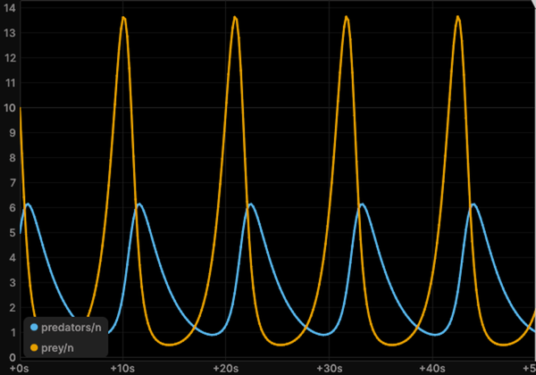<br><code>lotka_volterra</code><br><sub>Prey and predators cycle</sub></td>
    <td align="center" valign="top" width="33%">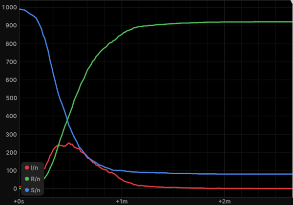<br><code>sir</code><br><sub>An epidemic rises and fades</sub></td>
    <td align="center" valign="top" width="33%">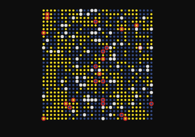<br><code>wolf_sheep</code><br><sub>Wolves, sheep and grass on a grid</sub></td>
  </tr>
</table>

The [catalog](https://georgedouzas.github.io/scikit-complexity/systems/catalog/) lists every system by field and topic,
and the page of each system shows the classes it is built from.

### Build a custom system

This section writes a predator and prey system from the core alone. An element declares its states. An interaction
declares its roles, the names of the elements it reads and changes, and returns its laws. In `_get_laws`, the
namespace `s` holds the symbols of its parameters and of the elements bound to its roles. The system takes one element
class, the general `RateInteraction`, and one new interaction.

```python
from typing import Annotated

from skcomplex.core.components.elements import Element
from skcomplex.core.components.interactions import Interaction, RateInteraction
from skcomplex.core.components.laws import RateLaw
from skcomplex.core.components.systems import CompositeSystem
from skcomplex.core.engine.runtime import simulate
from skcomplex.core.specs import ParameterSpec, RoleSpec, StateSpec


class PopulationElement(Element):
    def __init__(self, label, visual=None, *, n: Annotated[float, StateSpec()] = 1.0):
        super().__init__(label, visual=visual)
        self.n = n


class PredationInteraction(Interaction):
    def __init__(
        self,
        label,
        *,
        predator: Annotated[str, RoleSpec(states=('n',))],
        prey: Annotated[str, RoleSpec(states=('n',))],
        a: Annotated[float, ParameterSpec()] = 0.4,
        b: Annotated[float, ParameterSpec()] = 0.1,
    ):
        super().__init__(label)
        self.predator = predator
        self.prey = prey
        self.a = a
        self.b = b

    def _get_laws(self, s):
        contacts = s.predator.n * s.prey.n
        return [RateLaw(s.prey.n, -s.a * contacts), RateLaw(s.predator.n, s.b * contacts)]


system = CompositeSystem(
    elements=[PopulationElement('rabbits', n=40), PopulationElement('foxes', n=9)],
    interactions=[
        RateInteraction('growth', target='rabbits', state='n', rate=lambda s: 1.1 * s.target.n * (1 - s.target.n / 1000)),
        PredationInteraction('hunt', predator='foxes', prey='rabbits'),
        RateInteraction('death', target='foxes', state='n', rate=lambda s: -0.4 * s.target.n),
    ],
)
trajectory = simulate(system, until=30, dt=0.05)
round(float(trajectory.get_values('rabbits.n').max()))
```

The rabbits peak at 51. A `RerunObserver` records the run for the Rerun viewer, and
`RerunObserver('predators', spawn=True)` opens the viewer during the run. A schedule changes a parameter while the
system runs. Here it halves the hunting rate at time 15.

```python continuation
import tempfile
from pathlib import Path

from skcomplex.core.engine.viz import RerunObserver

recording = Path(tempfile.mkdtemp()) / 'predators.rrd'
trajectory = simulate(
    system,
    until=30,
    dt=0.05,
    observers=[RerunObserver('predators', save_path=recording)],
    schedule={'hunt.a': lambda t: 0.4 if t < 15 else 0.2},
)
float(trajectory.times[-1])
```

The run ends at time 30.0, with the hunting rate halved for its second half. A new process takes one more
interaction. Here a fishery harvests a fish stock in proportion to its size, and the analysis `symbolic` returns the
equations of the system.

```python continuation
from sage.all__sagemath_symbolics import oo
from sage.sets.real_set import RealSet

from skcomplex.core.analysis import symbolic


class HarvestInteraction(Interaction):
    def __init__(
        self,
        label,
        *,
        target: Annotated[str, RoleSpec(states=('n',))],
        h: Annotated[float, ParameterSpec(domain=RealSet.closed_open(0, oo))] = 0.1,
    ):
        super().__init__(label)
        self.target = target
        self.h = h

    def _get_laws(self, s):
        return [RateLaw(s.target.n, -s.h * s.target.n)]


harvested = CompositeSystem(
    elements=[PopulationElement('fish', n=500)],
    interactions=[
        RateInteraction('growth', target='fish', state='n', rate=lambda s: 0.5 * s.target.n * (1 - s.target.n / 1000)),
        HarvestInteraction('fishing', target='fish', h=0.1),
    ],
)
symbolic(harvested).equations['fish.n']
```

The equation of the stock is the logistic growth `-0.0005 (n - 1000) n` minus the harvest `h n`.

### Find out which components fit

This section checks that parts fit before you build a system with them. An interaction states what it needs from each
role, and an element states what it carries.

```python continuation
hunt = PredationInteraction('hunt', predator='foxes', prey='rabbits')
hunt.get_requirements().roles['prey'].states, list(PopulationElement('rabbits').get_states())
```

The role `prey` reads the state `n`, and `PopulationElement` carries `n`, so they fit. When a role is bound to an
element without the state it reads, `simulate` raises a `RoleElementError`.

```python continuation
from skcomplex.core.errors import RoleElementError


class TankElement(Element):
    def __init__(self, label, visual=None, *, level: Annotated[float, StateSpec()] = 1.0):
        super().__init__(label, visual=visual)
        self.level = level


wrong = CompositeSystem(
    elements=[TankElement('tank'), PopulationElement('foxes')],
    interactions=[PredationInteraction('hunt', predator='foxes', prey='tank')],
)
try:
    simulate(wrong, until=1)
except RoleElementError as error:
    message = str(error)
message
```

The message says that the role `prey` reads `n` but the element `tank` carries `level`. It proposes three fixes: bind
the role to an element that carries the state, declare the state on the element, or read another state.

The [parts pages](https://georgedouzas.github.io/scikit-complexity/parts/elements/) list every element, interaction, law,
solver, and backend with the tags they accept, and the
[user guide](https://georgedouzas.github.io/scikit-complexity/overview/user_guide/check/#what-an-interaction-needs)
walks through the choices in order.

## Spec-driven development

The project develops from specifications with [OpenSpec](https://github.com/Fission-AI/OpenSpec). Its engineering
constitution, `openspec/constitution.md`, binds all work, and `openspec/config.yaml` names it as binding.
