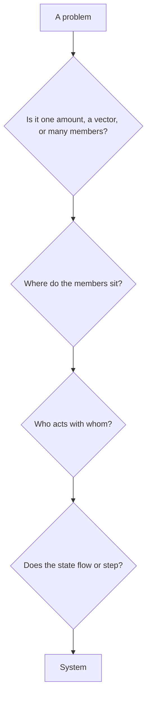
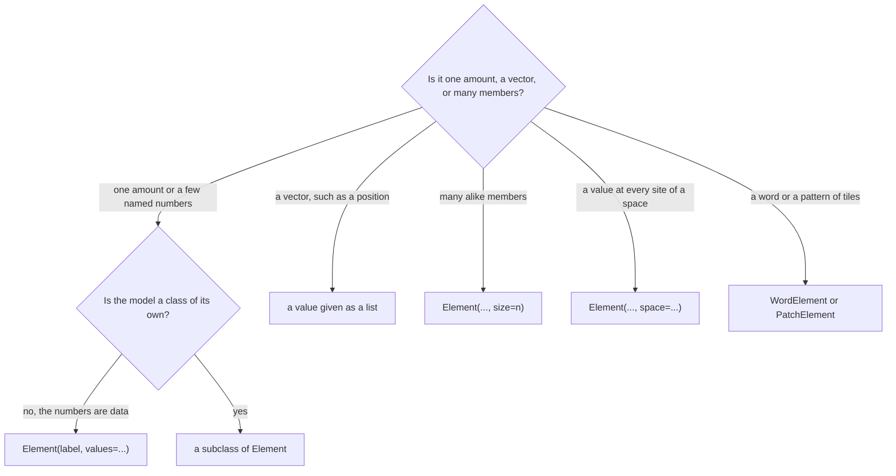
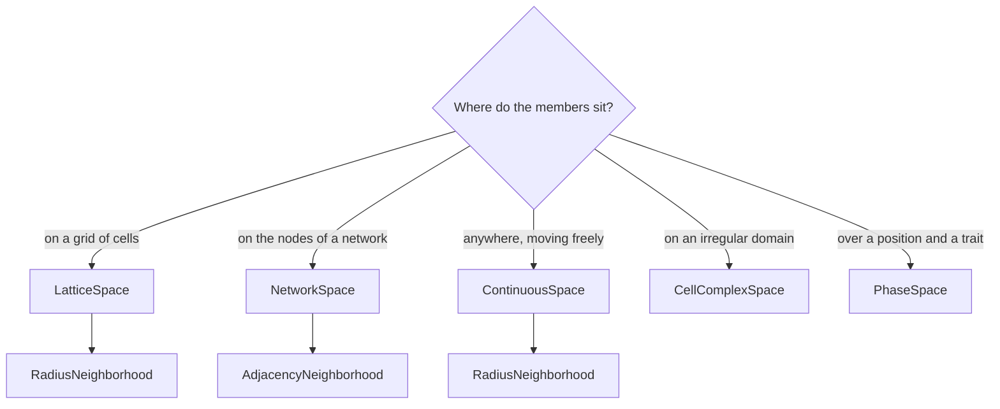
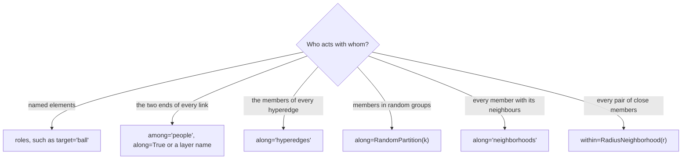
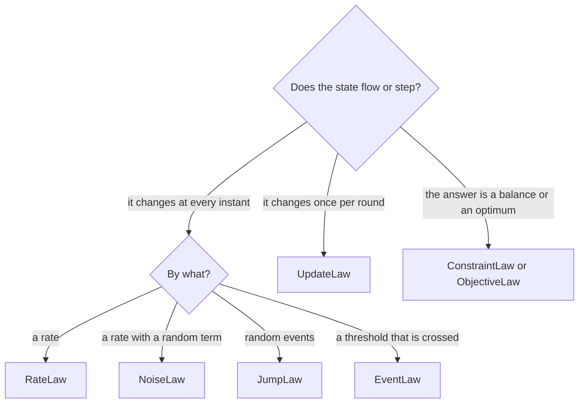

# Choosing components

This guide leads from the features of a problem to the components of the core that model it. Four questions, asked in
order, fix the element, the space, the interactions, and the kinds of their laws, and a
[`System`](systems.md#system) then holds the components. [How the components fit](index.md) explains each family, and
every leaf below links the reference section of its component.



A problem with one amount skips the second question, since one amount needs no space.

## Is it one amount, a vector, or many members?

This question fixes the element, the component that holds the values. One amount, or a few named numbers, sits in one
element. A vector, such as the position of a body, is one value with several entries. Many alike units, such as the
people of an epidemic or the cells of a grid, are the members of one element, and a quantity that has a value at every
site of a space has one member per site.



| Leaf | Component |
| --- | --- |
| the numbers are data | [`Element`](elements.md#element) with `values={'x': 1.0}` |
| the model is a class of its own | a subclass of [`Element`](elements.md#element) whose arguments are its values |
| a vector, such as a position | a value given as a list, such as `values={'x': [0.0, 1.0]}`, or the recipe [`PointElement`](general.md#pointelement) |
| many alike members | [`Element`](elements.md#element) with `size=n` and one value per member |
| a value at every site of a space | [`Element`](elements.md#element) with `space=`, or `on='edges'` for the links of a network |
| a word or a pattern of tiles | the recipe [`WordElement`](general.md#wordelement) or [`PatchElement`](general.md#patchelement) |

A value says what it may be through `Annotated`, only where it matters. An amount that cannot be negative, such as a
count or a sum of money, takes its allowed values, `Annotated[float, RealSet.closed_open(0, oo)]`, a category takes its
names, `Annotated[str, {'S', 'I', 'R'}]`, and an angle wraps around with
[`Period`](elements.md#period)`(2 * pi)`. [`Quantity`](elements.md#quantity) names what a value measures, such as an
energy, [`Member`](elements.md#member) points at a member of another element, and [`Tensor`](elements.md#tensor) gives
the symmetry of a matrix.

## Where do the members sit?

This question fixes the space of an element, which places its members and says who neighbours whom. Members on a grid
of cells sit on a lattice. Members joined by contacts, roads, or trades sit on the nodes of a network. Members that move
freely, such as particles or animals, sit in continuous space.



| Leaf | Space | Who neighbours whom |
| --- | --- | --- |
| on a grid of cells | [`LatticeSpace`](spaces.md#latticespace) | [`RadiusNeighborhood`](spaces.md#radiusneighborhood), the cells within a radius |
| on the nodes of a network | [`NetworkSpace`](spaces.md#networkspace) | [`AdjacencyNeighborhood`](spaces.md#adjacencyneighborhood), the nodes joined by an edge |
| anywhere, moving freely | [`ContinuousSpace`](spaces.md#continuousspace) | [`RadiusNeighborhood`](spaces.md#radiusneighborhood), the members within a distance |
| on an irregular domain | [`CellComplexSpace`](spaces.md#cellcomplexspace) of a mesh | the nodes that share a cell |
| over a position and a trait | [`PhaseSpace`](spaces.md#phasespace) | the classes at the same position |

An element takes the space as `space=...`. In a continuous space the values named after its axes, such as `x` and
`y`, are the positions of the members.

## Who acts with whom?

This question fixes the interactions and how they bind elements. Every interaction is an
[`Interaction`](interactions.md#interaction) that sets its laws, either a subclass whose `_prepare` sets `laws_` or a
one-off rule, `Interaction('decay', roles={'target': 'atoms'}, laws=lambda s: [...])`. What changes is a matter of
its binding.



| Leaf | Binding | The laws read |
| --- | --- | --- |
| named elements | roles, such as `target='ball'` | the elements, such as `s.target.x` |
| the two ends of every link | `among='people', along=True`, or the name of a layer | `s.source` and `s.target` |
| the members of every hyperedge | `along='hyperedges'`, or `('hyperedges', k)` for those of `k` members | `s.member`, `s.others`, and `s.members` |
| members in random groups | `along=`[`RandomPartition`](interactions.md#randompartition)`(k)` | `s.member`, `s.others`, and `s.members` |
| every member with its neighbours | `along='neighborhoods'` | `s.member`, `s.others`, and `s.members` |
| every pair of close members | `within=RadiusNeighborhood(r)` | `s.first` and `s.second` |

Inside the laws, the `neighbors` reduction reads the neighbours of every member, such as
`neighbors(s.target.other.x, reduce='mean')`.

The shared recipes of [General realizations](general.md) cover interactions that several fields use, such as
[`MovementInteraction`](general.md#movementinteraction) and [`ChoiceInteraction`](general.md#choiceinteraction), and
reactions at a product propensity with [`ReactionInteraction`](general.md#reactioninteraction).

## Does the state flow or step?

This question fixes the kind of each law, and the kinds fix the time of the system, which is never given. A state that
changes at every instant, such as a temperature or the size of a large population, flows. A state that changes once
per round, such as a yearly census or the move of a player, steps. A problem that asks for a balance or an optimum, and
not for a path, has no time at all.



| Leaf | Law | Time |
| --- | --- | --- |
| a rate | [`RateLaw`](laws.md#ratelaw), such as `RateLaw(x.diff(t), -k * x)` | continuous |
| a rate with a random term | [`NoiseLaw`](laws.md#noiselaw) beside a rate | continuous |
| random events | [`JumpLaw`](laws.md#jumplaw), with a change of each state | continuous |
| a threshold that is crossed | [`EventLaw`](laws.md#eventlaw) | continuous |
| the next value at a step | [`UpdateLaw`](laws.md#updatelaw), also for agent rules and for the local rules of cells with `neighborhood=` | discrete |
| a balance | [`ConstraintLaw`](laws.md#constraintlaw) | none |
| an optimum | [`ObjectiveLaw`](laws.md#objectivelaw) | none |

A flow that moves an amount from one stock to another is one `RateLaw` whose target maps each stock to the sign of its
change, `RateLaw({s.alive: -1, s.dead: +1}, f, label='deaths')`. An `UpdateLaw` beside rates corrects a value after
every step, such as a wall that keeps `x` at `abs(x)`. `prepare` records the problem the kinds add up to in `form_`.

## A worked path

This section follows the four questions for one problem and builds the components they lead to. A population of people
lives on a friendship network, and each day every person moves their opinion halfway towards the mean opinion of their
friends.

1. There are many alike people, each with an opinion `x`, so the element is an [`Element`](elements.md#element) with
   one opinion per person.
2. The people sit on the nodes of a network, so the space is a [`NetworkSpace`](spaces.md#networkspace).
3. Each person reads the mean of their neighbours, so the interaction binds the people as its role `target` and its law
   reads `neighbors(s.target.other.x, reduce='mean')`.
4. The opinions change once a day, so the law is an [`UpdateLaw`](laws.md#updatelaw), and the system steps.

The network is a path of three people with the opinions 0, 3, and 9.

```python
import networkx as nx

from skcomplex.core.components.elements import Element
from skcomplex.core.components.interactions import Interaction
from skcomplex.core.components.laws import UpdateLaw
from skcomplex.core.components.laws.utils import neighbors
from skcomplex.core.components.spaces import NetworkSpace
from skcomplex.core.systems import System
from skcomplex.core.types import Role


class AveragingInteraction(Interaction):
    def __init__(self, label, *, target: Role = 'people'):
        super().__init__(label)
        self.target = target

    def _prepare(self, s):
        super()._prepare(s)
        x = s.target.x
        self.laws_ = [UpdateLaw(x, (x + neighbors(s.target.other.x, reduce='mean')) / 2)]


friends = NetworkSpace(nx.path_graph(3))
people = Element('people', values={'x': [0.0, 3.0, 9.0]}, space=friends)
society = System(elements=[people], interactions=[AveragingInteraction('averaging')]).prepare()
trajectory = society.simulate(until=20)
trajectory.get_values('people.x')[[0, 1, 20]].round(3).tolist()
```

After one day the opinions read 1.5, 3.75, and 6.0, and after twenty days all three agree on 3.75. The middle person
has two friends, so the consensus weighs each opinion by the number of friends, `(0 + 2 * 3 + 9) / 4`. The prepared
system confirms the choices of the four questions.

```python continuation
society.form_, sorted(society.get_tags().space)
```

The form is `'discrete map'`, the next values that the update law sets once per step, and the space `['network']`.
