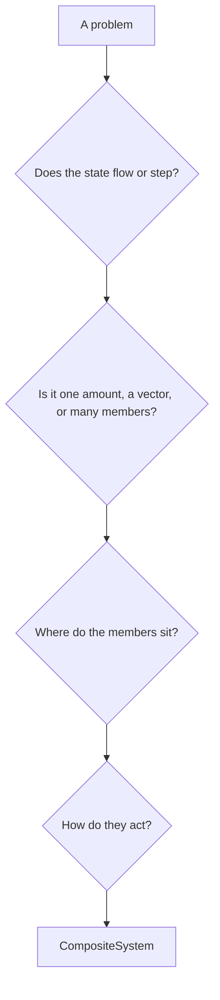
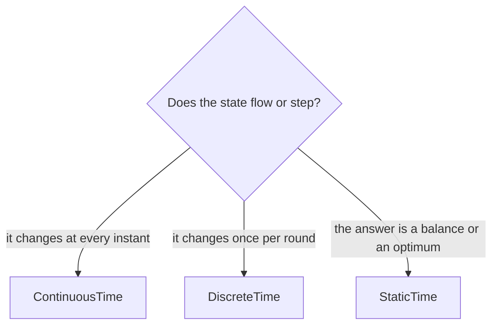
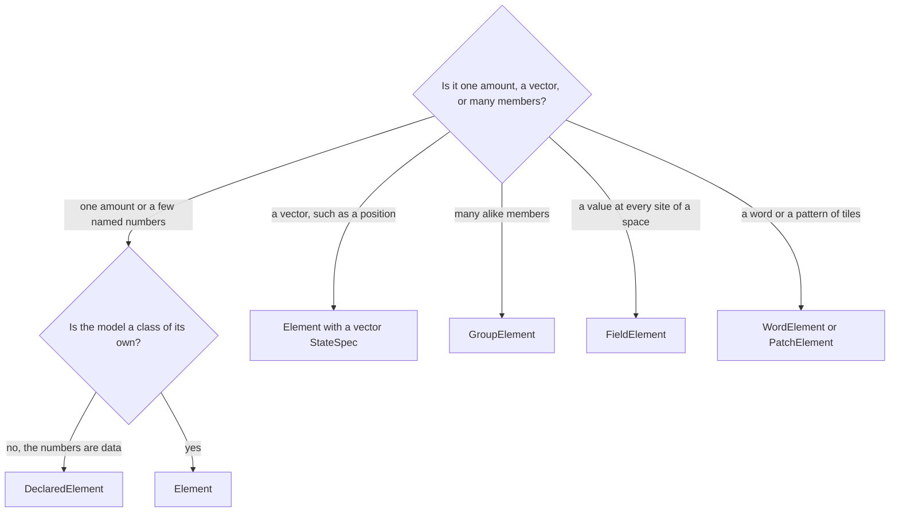
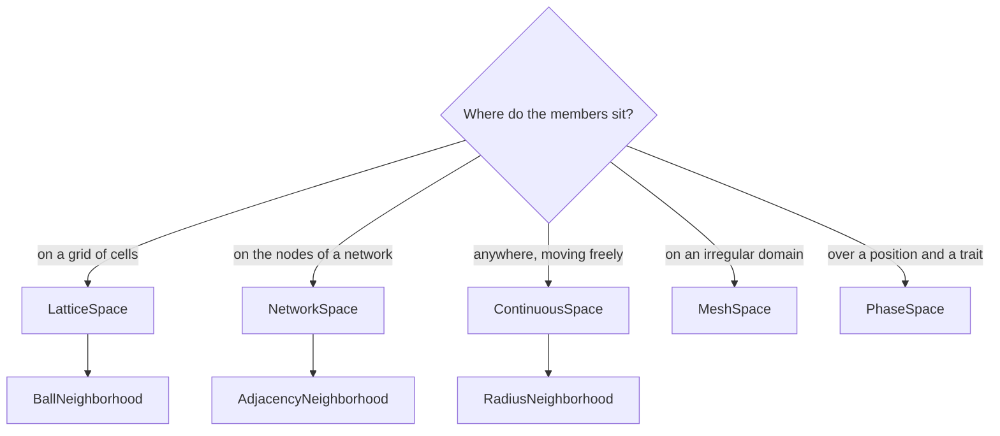
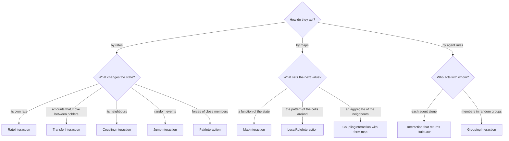

# Choosing components

This guide leads from the features of a problem to the components of the core that model it. Four questions, asked in
order, fix the time, the element, the space, and the interactions, and a [`CompositeSystem`](systems.md#compositesystem)
then holds the components. [How the components fit](index.md) explains each family, and every leaf below links the
reference section of its component.



A problem with one amount skips the third question, since one amount needs no space.

## Does the state flow or step?

This question fixes the time of the system, which decides the kinds of laws it may hold. A state that changes at every
instant, such as a temperature or the size of a large population, flows. A state that changes once per round, such as
a yearly census or the move of a player, steps. A problem that asks for a balance or an optimum, and not for a path,
has no time at all.



| Leaf | Component | Typical laws |
| --- | --- | --- |
| it changes at every instant | [`ContinuousTime`](spaces.md#continuoustime) | rates, noises, and random events |
| it changes once per round | [`DiscreteTime`](spaces.md#discretetime) | updates, local rules, and agent rules |
| the answer is a balance or an optimum | [`StaticTime`](spaces.md#statictime) | equations and objectives solved once |

`CompositeSystem` takes the time as `time=...`. Without one, a system of rate laws runs in continuous time.

## Is it one amount, a vector, or many members?

This question fixes the element, the component that holds the states. One amount, or a few named numbers, sits in one
element. A vector, such as the position of a body, is one state with several components. Many alike units, such as the
people of an epidemic on a network or the cells of a grid, are the members of a group, and a quantity that has a value
at every point of a space is a field.



| Leaf | Component |
| --- | --- |
| the numbers are data | [`DeclaredElement`](elements.md#declaredelement) |
| the model is a class of its own | [`Element`](elements.md#element) |
| a vector, such as a position | [`Element`](elements.md#element) with `StateSpec(vector=True)`, or the recipe [`PointElement`](general.md#pointelement) |
| many alike members | [`GroupElement`](elements.md#groupelement) |
| a value at every site of a space | [`FieldElement`](elements.md#fieldelement) |
| a word or a pattern of tiles | [`WordElement`](elements.md#wordelement) or [`PatchElement`](elements.md#patchelement) |

An amount that cannot be negative, such as a count or a sum of money, has the recipe
[`NonnegativeElement`](general.md#nonnegativeelement).

## Where do the members sit?

This question fixes the space of a group or a field, which places its members and says who neighbours whom. Members
on a grid of cells sit on a lattice. Members joined by contacts, roads, or trades sit on the nodes of a network. Members
that move freely, such as particles or animals, sit in continuous space.



| Leaf | Space | Who neighbours whom |
| --- | --- | --- |
| on a grid of cells | [`LatticeSpace`](spaces.md#latticespace) | [`BallNeighborhood`](spaces.md#ballneighborhood), the cells within a radius |
| on the nodes of a network | [`NetworkSpace`](spaces.md#networkspace) | [`AdjacencyNeighborhood`](spaces.md#adjacencyneighborhood), the nodes joined by an edge |
| anywhere, moving freely | [`ContinuousSpace`](spaces.md#continuousspace) | [`RadiusNeighborhood`](spaces.md#radiusneighborhood), the members within a distance |
| on an irregular domain | [`MeshSpace`](spaces.md#meshspace) | the cells of the mesh |
| over a position and a trait | [`PhaseSpace`](spaces.md#phasespace) | the classes at the same position |

A `GroupElement` takes the space as `space=...` and `on='sites'`, and a group on the links of a network takes
`on='edges'`.

## How do they act?

This question fixes the interactions, the components that read states and return the laws that change them. Members that
change at rates act through rate laws in continuous time. Members that set their next values once per step act
through maps. Agents that look around, decide, and act one after another follow agent rules.



| Leaf | Component |
| --- | --- |
| its own rate | [`RateInteraction`](interactions.md#rateinteraction) |
| amounts that move between holders | [`TransferInteraction`](interactions.md#transferinteraction) |
| its neighbours | [`CouplingInteraction`](interactions.md#couplinginteraction) |
| random events | [`JumpInteraction`](interactions.md#jumpinteraction), or [`TransitionInteraction`](interactions.md#transitioninteraction) for a few discrete states |
| forces of close members | [`PairInteraction`](interactions.md#pairinteraction) |
| a function of the state | [`MapInteraction`](interactions.md#mapinteraction) |
| the pattern of the cells around | [`LocalRuleInteraction`](interactions.md#localruleinteraction) |
| an aggregate of the neighbours | [`CouplingInteraction`](interactions.md#couplinginteraction) with `form='map'` |
| each agent alone | an [`Interaction`](interactions.md#interaction) that returns a [`RuleLaw`](laws.md#rulelaw) |
| members in random groups | [`GroupingInteraction`](interactions.md#groupinginteraction) |

The shared recipes of [General realizations](general.md) cover the agent rules that several fields use, such as
[`MovementInteraction`](general.md#movementinteraction) and [`ChoiceInteraction`](general.md#choiceinteraction), and
reactions at a product propensity with [`ReactionInteraction`](general.md#reactioninteraction).

## A worked path

This section follows the four questions for one problem and builds the components they lead to. A population of people
lives on a friendship network, and each day every person moves their opinion halfway towards the mean opinion of their
friends.

1. The opinions change once a day, so the state steps, and the time is [`DiscreteTime`](spaces.md#discretetime).
2. There are many alike people, so the element is a [`GroupElement`](elements.md#groupelement).
3. The people sit on the nodes of a network, so the space is a [`NetworkSpace`](spaces.md#networkspace).
4. Each person reads the mean of their neighbours and sets the next value, so the interaction is a
   [`CouplingInteraction`](interactions.md#couplinginteraction) with `form='map'`.

The network is a path of three people with the opinions 0, 3, and 9. The member class is a
[`DeclaredElement`](elements.md#declaredelement) with one state `x`, and `combine` sets the next opinion to the mean
of the own opinion and that of the friends.

```python
import networkx as nx

from skcomplex.core.components.elements import DeclaredElement, GroupElement
from skcomplex.core.components.interactions import CouplingInteraction
from skcomplex.core.components.spaces import DiscreteTime, NetworkSpace
from skcomplex.core.components.systems import CompositeSystem
from skcomplex.core.engine.runtime import simulate
from skcomplex.core.specs import DeclaredVariableSpec, StateSpec

opinions = {'variables': {'x': DeclaredVariableSpec(0.0, StateSpec())}, 'x': [0.0, 3.0, 9.0]}
friends = NetworkSpace(nx.path_graph(3))
people = GroupElement('people', element=DeclaredElement, space=friends, on='sites', values=opinions)
averaging = CouplingInteraction(
    'averaging',
    target='people',
    function=lambda s: s.other.x,
    reduce='mean',
    form='map',
    combine=lambda s, mean: (s.member.x + mean) / 2,
)
society = CompositeSystem(elements=[people], interactions=[averaging], time=DiscreteTime())
trajectory = simulate(society, until=20)
trajectory.get_values('people.x')[[0, 1, 20]].round(3).tolist()
```

After one day the opinions read 1.5, 3.75, and 6.0, and after twenty days all three agree on 3.75. The middle person
has two friends, so the consensus weighs each opinion by the number of friends, `(0 + 2 * 3 + 9) / 4`. The tags
confirm the choices of the four questions.

```python continuation
tags = society.get_tags()
sorted(tags.time), sorted(tags.space), sorted(tags.laws)
```

The time is `['discrete']`, the space `['network']`, and the laws `['update']`, the next values that the map sets
once per step.
