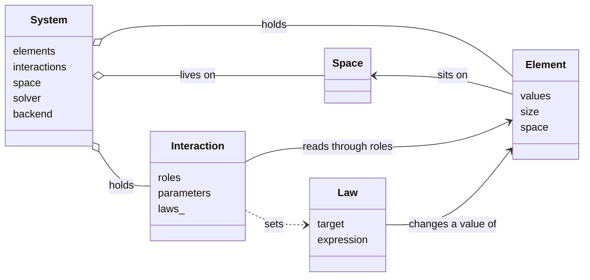
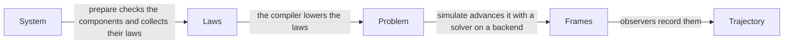

# How the components fit

This page explains the components that every [system](../glossary.md#system) is made of and how a run turns them into
numbers. It ends with a predator and its prey on a lattice, built one component at a time.

## The components

An [element](../glossary.md#element) holds values, such as the size of a population or the mass of a ball. An
[interaction](../glossary.md#interaction) binds elements through its [roles](../glossary.md#role) and sets the
[laws](../glossary.md#law) that change their values. A law is one piece of mathematics, such as a rate or the next
value at a step. A value that some law changes is a [state](../glossary.md#state), and any other value is a parameter.
A [space](../glossary.md#space) places the [members](../glossary.md#member) of an element and says who neighbours whom.
A `System` holds all of them, and the kinds of its laws decide whether it flows, steps, or is solved once.



None of these words belongs to one field. A population, a chemical species, a bank account, and a cell of a lattice are
all elements, and an epidemic, a reaction, and a payment are all interactions.

## A run

`prepare` and `simulate` take a system to a [trajectory](../glossary.md#trajectory), as `fit` and `predict` take a
scikit-learn estimator to its predictions.



`prepare` checks every component, binds every role to an element, and collects the laws. The
[compiler](../glossary.md#compiler) reads the laws and builds a problem of one mathematical form, such as a system of
[ordinary differential equations](../glossary.md#ordinary-differential-equation), and `prepare` keeps it. `simulate`
then runs the prepared problem as often as asked. A [solver](../glossary.md#solver) advances it from
[frame](../glossary.md#frame) to frame, and a [backend](../glossary.md#backend), NumPy by default, evaluates its
functions. [Observers](../glossary.md#observer) receive the frames, and the recorder keeps them as the trajectory that
`simulate` returns.

## A system step by step

Prey grow and predators hunt them on every site of a lattice, and prey move between neighbouring sites. Each step below
adds one component.

### The elements

An element class takes its values as arguments of its `__init__`, and the default of each argument is its starting
value. `Annotated` gives the values a value may take, here any amount from zero up. With `space=`, the element holds one
member on every site, so a value may be one number per site.

```python
from typing import Annotated

import numpy as np
from sage.all__sagemath_symbolics import oo
from sage.sets.real_set import RealSet

from skcomplex.core.components.elements import Element

AMOUNT = RealSet.closed_open(0, oo)


class HabitatElement(Element):
    def __init__(
        self,
        label,
        *,
        prey: Annotated[float, AMOUNT] = 1.0,
        predators: Annotated[float, AMOUNT] = 0.5,
        space=None,
    ):
        super().__init__(label, space=space)
        self.prey = prey
        self.predators = predators


rng = np.random.default_rng(0)
start = rng.uniform(0.5, 1.5, 25)
start[:3].round(2).tolist()
```

### The interactions

An interaction sets its laws in `_prepare`, where `s` holds the elements its roles bind and `s.t` the time. Predation
gives the local equations of Lotka and Volterra. Prey grow at rate one and are eaten in proportion to the predators,
and predators grow in proportion to the prey and die at rate one. A rate law of the derivative `x.diff(t)` is the rate
of change of `x`.

```python continuation
from skcomplex.core.components.interactions import Interaction
from skcomplex.core.components.laws import RateLaw
from skcomplex.core.types import Role


class PredationInteraction(Interaction):
    def __init__(self, label, *, target: Role = 'habitats'):
        super().__init__(label)
        self.target = target

    def _prepare(self, s):
        super()._prepare(s)
        prey, predators = s.target.prey, s.target.predators
        self.laws_ = [
            RateLaw(prey.diff(s.t), prey * (1.0 - predators)),
            RateLaw(predators.diff(s.t), predators * (prey - 1.0)),
        ]


class DispersalInteraction(Interaction):
    def __init__(self, label, *, among: Role = 'habitats', along=True):
        super().__init__(label, among=among, along=along)

    def _prepare(self, s):
        super()._prepare(s)
        flow = s.source.prey - s.target.prey
        self.laws_ = [RateLaw(s.target.prey.diff(s.t), flow), RateLaw(s.source.prey.diff(s.t), -flow)]


predation = PredationInteraction('predation')
dispersal = DispersalInteraction('dispersal')
predation.get_params()
```

Dispersal moves prey between neighbouring sites. With `along=True` its laws run once for every edge of the space and
read the two ends as `s.source` and `s.target`, so prey flow from crowded sites to empty ones.

### The space

A `LatticeSpace` of five by five sites holds the 25 members of the element. Its periodic boundary joins opposite edges,
so every site has the same number of neighbours.

```python continuation
from skcomplex.core.components.spaces import LatticeSpace

grid = LatticeSpace((5, 5), boundary='periodic')
grid.prepare().size_
```

### The system

A `System` holds the components. `prepare` finds the states, the values that the laws change, and the form of the
problem. The laws are rates, so the system flows in continuous time without naming it.

```python continuation
from skcomplex.core.systems import System

habitats = HabitatElement('habitats', prey=start, space=grid)
ecosystem = System(elements=[habitats], interactions=[predation, dispersal]).prepare()
ecosystem.states_, ecosystem.form_
```

The states are the prey and the predators of every site, `habitats.prey[i]` and `habitats.predators[i]`, and the form
is ordinary differential equations.

### The run

`simulate` runs the prepared system and returns the trajectory. The mean prey over the lattice rises and falls in the
cycles of Lotka and Volterra.

```python continuation
trajectory = ecosystem.simulate(until=10, dt=1.0)
trajectory.get_values('habitats.prey').mean(axis=1).round(2).tolist()
```

## The main public methods

Every component has the [main public method](../glossary.md#main-public-methods) `prepare`, which returns the component
itself. It checks the component against what it works on, such as the space of its system, and an interaction sets its
laws in `laws_` when it is prepared for the elements it binds. A `System` has a second one, `simulate`, which returns a
trajectory, so one prepared system runs many times. Every component also has `get_params`, `set_params`, and
`get_tags`, as scikit-learn estimators do.

A prepared system shows the equations its laws add up to, one per state, before it runs.

```python continuation
ecosystem.equations_['habitats.predators[i]']
```

## Laws and the default solver

The kinds of law of a system decide the form of its problem and the default solver.

| Laws | Form | Default solver |
| --- | --- | --- |
| `RateLaw` | ordinary differential equations | `ScipyODESolver` with `LSODA` |
| `RateLaw` and `NoiseLaw` | stochastic differential equations | `EulerMaruyamaSolver` |
| `JumpLaw` | jump process | `GillespieSolver` |
| `UpdateLaw` | discrete map | `IterationSolver` |

A run also records [observables](../glossary.md#observable), named values computed from the states at every frame, and
checks the [invariants](../glossary.md#invariant) it is given.

## Where the components live

| Family | Import from | Reference |
| --- | --- | --- |
| Elements | `skcomplex.core.components.elements` | [Elements](elements.md) |
| Interactions | `skcomplex.core.components.interactions` | |
| Laws | `skcomplex.core.components.laws` | |
| Spaces and neighbourhoods | `skcomplex.core.components.spaces` | [Spaces](spaces.md) |
| Systems | `skcomplex.core.systems` | |
| Running and recording | `skcomplex.core.engine.runtime` | |
| Shared recipes | `skcomplex.systems.general` | [General realizations](general.md) |
