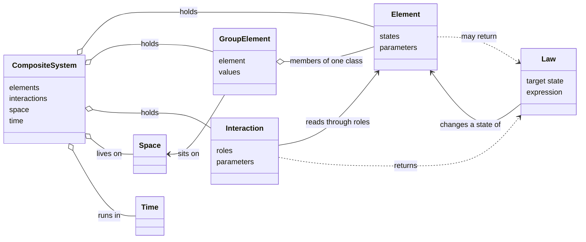
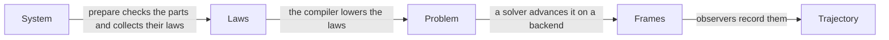

# How the parts fit

This page explains the parts that every system is made of and how a run turns them into numbers. It ends with a
predator and its prey on a lattice, built one part at a time.

## The parts

An element holds states, the numbers that change as the system runs, such as the size of a population. An interaction
reads states through its roles and returns laws that change them. A law is one equation or rule for one state, such as
a rate or the next value at a step. A space places the members of a group and says who neighbours whom. A time says
whether the system flows, steps, or is solved once. A system composes all of them.



None of these words belongs to one field. A population, a chemical species, a bank account, and a cell of a lattice are
all elements, and an epidemic, a reaction, and a payment are all interactions.

## A run

`simulate` takes a system to a trajectory in four stages.



`prepare` checks every part and binds every role to an element. The compiler reads the laws of the parts and builds a
problem of one mathematical form, such as a system of ordinary differential equations. A solver advances the problem
from frame to frame, and a backend, NumPy by default, evaluates its functions. Observers receive the frames, and the
recorder keeps them as the trajectory that `simulate` returns.

## A system step by step

Prey grow and predators hunt them on every site of a lattice, and prey move between neighbouring sites. Each step below
adds one part and runs what it has so far.

### The elements

An element class declares its states as arguments of its `__init__`, each annotated with a `StateSpec`. The default of
each argument is the initial value of the state. A `GroupElement` holds one member of that class on every site.

```python
from typing import Annotated

import numpy as np
from sage.all__sagemath_symbolics import oo
from sage.sets.real_set import RealSet

from skcomplex.core.components.elements import Element, GroupElement
from skcomplex.core.specs import StateSpec

AMOUNT = StateSpec(domain=RealSet.closed_open(0, oo))


class HabitatElement(Element):
    def __init__(
        self,
        label,
        visual=None,
        *,
        prey: Annotated[float, AMOUNT] = 1.0,
        predators: Annotated[float, AMOUNT] = 0.5,
    ):
        super().__init__(label, visual=visual)
        self.prey = prey
        self.predators = predators


rng = np.random.default_rng(0)
habitats = GroupElement('habitats', element=HabitatElement, on='sites', values={'prey': rng.uniform(0.5, 1.5, 25)})
habitats.values['prey'][:3].round(2).tolist()
```

### The interactions

Two `RateInteraction` parts give the local equations of Lotka and Volterra. Prey grow at rate one and are eaten in
proportion to the predators, and predators grow in proportion to the prey and die at rate one. Each interaction names
the states its role reads.

```python continuation
from skcomplex.core.components.interactions import CouplingInteraction, RateInteraction

births = RateInteraction(
    'births', target='habitats', state='prey', rate=lambda s: s.target.prey * (1.0 - s.target.predators)
)
hunting = RateInteraction(
    'hunting', target='habitats', state='predators', rate=lambda s: s.target.predators * (s.target.prey - 1.0)
)
births.get_requirements().roles['target'].states
```

A `CouplingInteraction` moves prey between neighbouring sites. Each site gains the difference between the prey of each
neighbour and its own, so prey flow from crowded sites to empty ones.

```python continuation
dispersal = CouplingInteraction('dispersal', target='habitats', read='prey', write='prey', mode='edges')
dispersal.get_requirements().roles['target'].states
```

### The space

A `LatticeSpace` of five by five sites holds the 25 members of the group. Its periodic boundary joins opposite edges,
so every site has the same number of neighbours.

```python continuation
from skcomplex.core.components.spaces import LatticeSpace

grid = LatticeSpace((5, 5), boundary='periodic')
grid.prepare().size_
```

### The time

The populations change at every instant, so the system runs in `ContinuousTime`.

```python continuation
from skcomplex.core.components.spaces import ContinuousTime

time = ContinuousTime()
```

### The system

A `CompositeSystem` holds the parts. Its tags come from them: rate laws in continuous time.

```python continuation
from skcomplex.core.components.systems import CompositeSystem

ecosystem = CompositeSystem(
    elements=[habitats], interactions=[births, hunting, dispersal], space=grid, time=time
)
sorted(ecosystem.get_tags().laws), sorted(ecosystem.get_tags().time)
```

### The run

`simulate` prepares the system, chooses a solver from its tags, and returns the trajectory. The mean prey over the
lattice rises and falls in the cycles of Lotka and Volterra.

```python continuation
from skcomplex.core.engine.runtime import simulate

trajectory = simulate(ecosystem, until=10, dt=1.0)
trajectory.get_values('habitats.prey').mean(axis=1).round(2).tolist()
```

## The main public methods

Every part has two main public methods, and both return the part itself. `prepare` checks the part against what it
works on, such as the space of its system. `run` sets what the part contributes: the laws of an element, an
interaction, or a system in `laws_`, and the value of a law in `value_`. A part runs only after it is prepared. Every
part also has `get_params`, `set_params`, and `get_tags`, as scikit-learn estimators do. `simulate` is a function,
since it is what is done to a system and not a part of it.

A law runs on its own too, so it can be checked before it joins a system. This rate law gives its rate at `x = 10`.

```python continuation
from sage.all__sagemath_symbolics import var

from skcomplex.core.components.laws import RateLaw

x = var('x')
RateLaw(x, 0.5 * x).prepare('growth').run({'x': 10.0}).value_
```

## Laws and the default solver

The laws of a system give its tags, and the tags decide the default solver.

| Laws | Form | Default solver |
| --- | --- | --- |
| `RateLaw` | ordinary differential equations | `ScipyODESolver` with `LSODA` |
| `RateLaw` and `NoiseLaw` | stochastic differential equations | `EulerMaruyamaSolver` |
| `JumpLaw` | jump process | `GillespieSolver` |
| `UpdateLaw` | discrete map | `IterationSolver` |

A run also records observables, named values computed from the states at every frame, and checks the invariants it is
given.

## Where the parts live

| Family | Import from | Reference |
| --- | --- | --- |
| Elements | `skcomplex.core.components.elements` | [Elements](elements.md) |
| Interactions | `skcomplex.core.components.interactions` | |
| Laws | `skcomplex.core.components.laws` | |
| Spaces, neighbourhoods, and times | `skcomplex.core.components.spaces` | |
| Systems | `skcomplex.core.components.systems` | |
| Specs | `skcomplex.core.specs` | |
| Simulation | `skcomplex.core.engine.runtime` | |
| Shared recipes | `skcomplex.systems.general` | [General realizations](general.md) |
